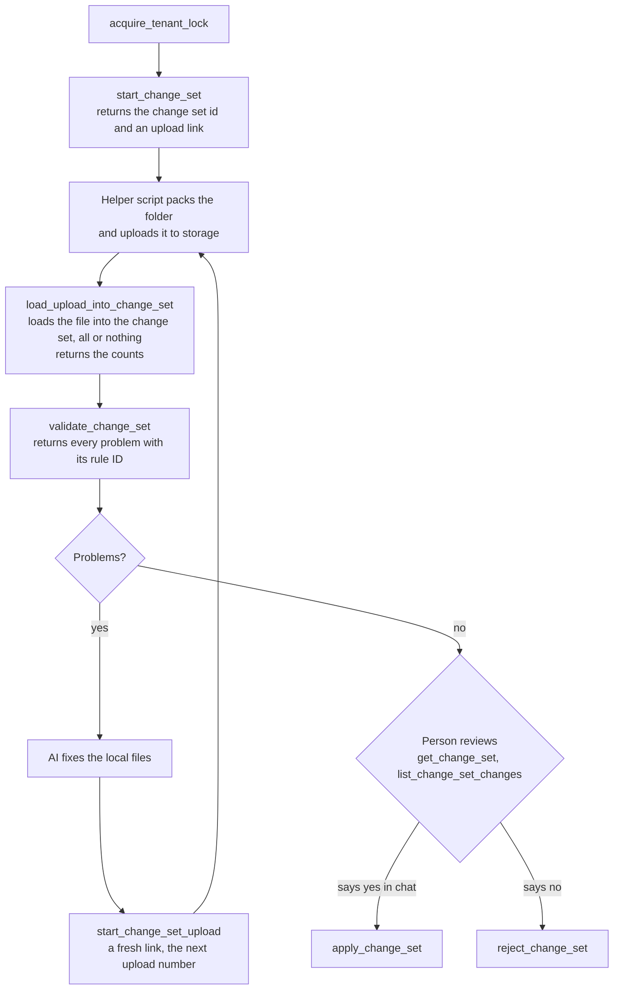

# Operations: snapshots and change sets

A hand edit, a Run and a push all end in the same change set, and from there the same operations validate, show,
apply and reject it. Each workflow adds only two things to this engine: the rules for its own records, and how its
records are saved at Apply. Columns and the rules every call gets are in the [README](README.md). Agreed with Maaz
on Nov 21.

## Flow of a push



## The two kinds

Every tool takes `kind` as its first input. It is always required and never guessed (Nov 21, Maaz). One set of
tools serves both kinds, so nothing is written twice.

| | `"project"` | `"metadata"` |
|---|---|---|
| What it is | One project's scope, Notes, models, mappings, code and validation | One tenant's tables, columns, ingestion lineage and pipelines |
| Named by | `tenant_code` and `project_name` | `tenant_code` only |
| Table behind it | `application.project_change_set` | `application.metadata_change_set` |
| Id in the answer | `project_change_set_id` | `metadata_change_set_id` |
| Title, status, source in the answer | `project_change_set_title`, `_status`, `_source` | `metadata_change_set_title`, `_status`, `_source` |
| Version it was built on | `base_project_version` | `base_metadata_version` |
| Version now | `project_version` | `tenant_metadata_version` |
| Stale version rule | CHANGE-SET-002 | CHANGE-SET-007 |
| Lock that blocks it | project lock, `is_locked` (CHANGE-SET-004) | catalog lock, `is_metadata_locked` (CHANGE-SET-011) |
| Storage path | `pull/ACME/Sales/...`, `push/ACME/Sales/...` | `pull/ACME/_metadata/...`, `push/ACME/_metadata/...` |

- The word is "metadata", not "catalog", because the tables, the version and the lock all say metadata, and "catalog"
  already means the Databricks catalog (`tenant_catalog`).
- Four inputs are the same word for both kinds, because one tool cannot have two names for one input: `kind`,
  `change_set_id`, `title`, `status`. Every answer repeats `kind` and then uses the exact column names of that kind.
- If `kind` is `"project"` and `project_name` is missing, the tool is refused and says so.

## Operations

The status goes: receiving (started, nothing loaded), then draft (loaded), then applied or rejected.

| # | Operation | Web | MCP tool | `core/` | Needs |
|---|---|---|---|---|---|
| B1 | Make a snapshot: write the files of a project, or of a tenant's metadata, into a zip in storage and return a download link and the version | - | `create_snapshot` | `bridge.create_snapshot` | `READ` |
| C1 | Make a draft from records typed or clicked in the web app (a hand edit) | `POST /api/projects/{p}/change-sets` **Built** | - | `change_sets.make_draft` **Built** | `CHANGE` |
| C2 | Start an empty change set for a push and get the first upload link | - | `start_change_set` | `change_sets.start` | `CHANGE` |
| C3 | Get a fresh upload link, with the next upload number | - | `start_change_set_upload` | `change_sets.start_upload` | `CHANGE` |
| C4 | Load an upload: read the zip from storage, work out what changed against what is saved, replace the change set's contents. All or nothing | - | `load_upload_into_change_set` | `change_sets.load_upload` | `CHANGE` |
| C5 | Validate: run the rules and return every problem with its rule ID. Changes nothing | `GET /api/change-sets/{kind}/{c}/problems` **Built** | `validate_change_set` **Built** | `change_sets.validate` **Built** | `READ` |
| C6 | List change sets, newest first | `GET /api/tenants/{t}/change-sets` **Built** | `list_change_sets` **Built** | `change_sets.list_change_sets` **Built** | `READ` |
| C7 | See one change set: status fields and the count for each list of records | `GET /api/change-sets/{kind}/{c}` **Built** | `get_change_set` **Built** | `change_sets.get_change_set` **Built** | `READ` |
| C8 | List a change set's changes: which records are added, changed or switched off, with the current values next to a change | `GET /api/change-sets/{kind}/{c}/changes` **Built** | `list_change_set_changes` **Built** | `change_sets.list_changes` **Built** | `READ` |
| C9 | Adjust a draft during review: change or take out single records | planned with the first AI step | - | `change_sets.edit_draft` | `CHANGE` |
| C10 | Apply: run the rules again, save everything in one go or nothing, the version goes up by one | `POST /api/change-sets/{kind}/{c}/apply` **Built** | `apply_change_set` **Built** | `change_sets.apply` **Built** | `CHANGE` |
| C11 | Reject: mark it rejected with who and when. Nothing else changes | `POST /api/change-sets/{kind}/{c}/reject` **Built** | `reject_change_set` **Built** | `change_sets.reject` **Built** | `CHANGE` |

**Rules, beyond the ones every call gets**

- C4: CHANGE-SET-002 (or 007) already at load, using the version the snapshot was taken at. A push built on an old
  snapshot is refused before anyone reviews it: pull again and redo the changes on top, as in the web app.
- C5, C10: CHANGE-SET-001, 002 (or 007), 003, 005, plus the rules of every part that has records (for scope:
  SCOPE-001 and 002).
- C10: also refused when the change set now holds a different upload than the one that was reviewed.
- C11: CHANGE-SET-001, which lets a change set that is still receiving be rejected.

**Decided (Nov 21, Maaz)**

- A push works through one change set. A new upload replaces everything in it.
- A push never deletes. A row missing from the upload is left alone; a row is taken out by switching it off
  (`is_active` false). The same holds for a Run and a hand edit.
- Loading and validating are two tools. Loading says in numbers what the push would do; validating runs the rules.
- Problems are never stored. They are worked out fresh each time, so they cannot go stale.
- The scope functions built in step 3d became the shared engine in step 4c2 (`core/change_sets.py`, with the parts in
  `core/parts.py` and the rules in `core/rules.py`). The web routes are the ones in the README (`/change-sets`).
  Only project change sets are built; metadata change sets come with the metadata snapshot.
- A change set has to remember which upload it holds. Both change set tables get one new column, `upload_number`
  (empty until an upload is loaded).

## What a snapshot holds

A snapshot is the zip a pull downloads. The helper script unpacks it and keeps the zip as the clean copy.

- `gds.json`: the kind, tenant code, project name, the version the snapshot was taken at and the snapshot id. A push
  sends it back, which is how the server knows the version the files were built on.
- `README.md`: the rules and the shape of each kind of file, so the AI needs no tool to ask.
- **Project:** the settings, the scope, context records, subject areas, relationships, models, mappings, validation
  and code. For each table in scope it also carries the table's columns and profile, because there is no tool to read
  them one by one.
- **Metadata:** the tables whose source tenant is this tenant, with their columns, ingestion lineage and their copy,
  member and process groups. To choose scope, the AI takes a metadata snapshot of its own tenant and of a global
  tenant such as the lake.
- Names and codes, never ids.

The folder layout and file formats are in [`design/vscode/bridge.md`](../vscode/bridge.md) (Nov 28, Maaz).

## The helper script

One Python file that uses only what comes with Python. Two commands, no rules, no sign-in.

| Command | Does |
|---|---|
| `pull <download link> <folder>` | Downloads the snapshot, keeps the zip in the folder as the clean copy, unpacks it |
| `push <upload link> <folder>` | Packs the folder (without the clean copy) and uploads it |

The AI saves the answer of `validate_change_set` as `problems.json` in the folder; the Extension Bridge saves the same
file itself. The Local Workbench page reads that file.

## The tools

The examples use a project. Where the metadata answer has different fields, it is shown too.

### `create_snapshot`

**Used for:** getting the link the helper script downloads, and noting the version the files are at.

```json
Input
{ "kind": "project", "tenant_code": "ACME", "project_name": "Sales" }

Output
{
  "kind": "project",
  "snapshot_id": "2026-11-21-0042",
  "tenant_code": "ACME",
  "project_name": "Sales",
  "project_version": 7,
  "download_link": "https://<storage>/pull/ACME/Sales/2026-11-21/2026-11-21-0042.zip?<signature>",
  "link_expires_time": "2026-11-21T14:45:00Z"
}

Input for metadata
{ "kind": "metadata", "tenant_code": "ACME" }

Output for metadata
{
  "kind": "metadata",
  "snapshot_id": "2026-11-21-0043",
  "tenant_code": "ACME",
  "tenant_metadata_version": 3,
  "download_link": "https://<storage>/pull/ACME/_metadata/2026-11-21/2026-11-21-0043.zip?<signature>",
  "link_expires_time": "2026-11-21T14:45:00Z"
}
```

Worked out: `snapshot_id`, the link and its end time. A snapshot is not stored in the database.

### `start_change_set`

**Used for:** opening the one change set a push works through, and getting the first upload link.

```json
Input
{ "kind": "project", "tenant_code": "ACME", "project_name": "Sales", "title": "Add CRM tables to scope" }

Output
{
  "kind": "project",
  "project_change_set_id": 412,
  "project_change_set_title": "Add CRM tables to scope",
  "project_change_set_status": "receiving",
  "upload_number": 1,
  "upload_link": "https://<storage>/push/ACME/Sales/2026-11-21/412/upload-1.zip?<signature>",
  "link_expires_time": "2026-11-21T14:45:00Z"
}
```

For metadata the input has no `project_name` and the answer has the `metadata_change_set_` fields.

### `start_change_set_upload`

**Used for:** sending the files again after fixing them, or when a link ran out before it was used.

```json
Input
{ "kind": "project", "change_set_id": 412 }

Output
{
  "kind": "project",
  "project_change_set_id": 412,
  "upload_number": 2,
  "upload_link": "https://<storage>/push/ACME/Sales/2026-11-21/412/upload-2.zip?<signature>",
  "link_expires_time": "2026-11-21T15:10:00Z"
}
```

### `load_upload_into_change_set`

**Used for:** taking the file the helper script put in storage and loading it into the change set in Postgres. It
answers in numbers what the push would do.

```json
Input
{ "kind": "project", "change_set_id": 412, "upload_number": 2 }

Output
{
  "kind": "project",
  "project_change_set_id": 412,
  "project_change_set_status": "draft",
  "upload_number": 2,
  "base_project_version": 7,
  "counts": {
    "project_input_scope": { "added": 3, "changed": 1, "switched_off": 1, "unchanged": 18 },
    "operational_entity": { "added": 0, "changed": 0, "switched_off": 0, "unchanged": 14 }
  }
}
```

- The version is read from `gds.json` in the upload. If the project (or the tenant's metadata) has moved on since
  the snapshot, the load is refused and nothing changes.
- Worked out: `counts`, one entry for each list of records the upload touches.
- A file that cannot be read stops the whole load. The error names the file and what is wrong with it.
- For metadata the answer has `metadata_change_set_id`, `metadata_change_set_status` and `base_metadata_version`.

### `validate_change_set`

**Used for:** finding out what must be fixed before Apply, in a form the AI can act on file by file. This answer is
what gets saved as `problems.json`.

```json
Input
{ "kind": "project", "change_set_id": 412 }

Output
{
  "kind": "project",
  "project_change_set_id": 412,
  "project_change_set_status": "draft",
  "upload_number": 2,
  "can_apply": false,
  "problems": [
    {
      "rule_id": "SCOPE-001",
      "level": "blocks_apply",
      "message": "gold.fact_sales is a Gold table. Only Source and Bronze tables can be in scope.",
      "part": "project_input_scope",
      "record": 3,
      "row_key": {
        "tenant_code": "GDS", "system_code": "GDS_US", "connection_code": "gds_us",
        "object_schema": "gold", "object_name": "fact_sales"
      },
      "file": "scope.jsonl",
      "line": 4
    }
  ]
}
```

- `rule_id`, `message` and `record` (the record's position in its part) are what `core/` returns today. `level` is
  `blocks_apply` or `warning`.
- `part`, `row_key`, `file` and `line` let the AI find the thing to fix without counting. A problem about the whole
  change set, such as a stale version, has these four empty.
- Worked out: `can_apply`, true when no problem blocks Apply.

### `get_change_set`

**Used for:** seeing where a change set stands: its status, who made it and how, whether the project or metadata has
moved on since, and the size of the change.

```json
Input
{ "kind": "project", "change_set_id": 412 }

Output
{
  "kind": "project",
  "project_change_set_id": 412,
  "tenant_code": "ACME",
  "project_name": "Sales",
  "project_change_set_title": "Add CRM tables to scope",
  "project_change_set_status": "draft",
  "project_change_set_source": "vscode_push",
  "base_project_version": 7,
  "project_version": 7,
  "is_locked": false,
  "upload_number": 2,
  "created_by_display_name": "Ben",
  "created_time": "2026-11-21T14:30:00Z",
  "decided_by_display_name": null,
  "decided_time": null,
  "counts": {
    "project_input_scope": { "added": 3, "changed": 1, "switched_off": 1, "unchanged": 18 }
  }
}

Output for metadata
{
  "kind": "metadata",
  "metadata_change_set_id": 57,
  "tenant_code": "ACME",
  "metadata_change_set_title": "New columns on bronze_erp.orders",
  "metadata_change_set_status": "draft",
  "metadata_change_set_source": "vscode_push",
  "base_metadata_version": 3,
  "tenant_metadata_version": 3,
  "is_metadata_locked": false,
  "upload_number": 1,
  "created_by_display_name": "Ben",
  "created_time": "2026-11-21T14:30:00Z",
  "decided_by_display_name": null,
  "decided_time": null,
  "counts": {
    "attribute": { "added": 4, "changed": 0, "switched_off": 0, "unchanged": 2210 }
  }
}
```

- Source is `vscode_push`, `ai_run` or `web_app_edit`, so a draft made in the web app can be looked at here too.
- The version now sits next to the version the change set was built on. If they differ, it can no longer be applied.
- The lock (`is_locked` or `is_metadata_locked`) is the other usual reason a change set cannot be applied.
- It does not return problems. That is `validate_change_set`.

### `list_change_set_changes`

**Used for:** reviewing what will actually change, record by record, before the person says yes. `get_change_set`
says "3 added, 1 changed"; this says which ones and what the change is.

```json
Input
{ "kind": "project", "change_set_id": 412, "part": "project_input_scope", "change": "changed", "page": 1 }

Output
{
  "kind": "project",
  "project_change_set_id": 412,
  "part": "project_input_scope",
  "page": 1,
  "page_size": 50,
  "total": 1,
  "changes": [
    {
      "change": "changed",
      "record": {
        "tenant_code": "GDS", "system_code": "GDS_US", "connection_code": "gds_us",
        "object_schema": "bronze_erp", "object_name": "orders",
        "is_active": true, "is_locked": true
      },
      "current": { "is_active": true, "is_locked": false }
    }
  ]
}
```

- `part` is one of the lists named in `counts`. `change` is optional: `added`, `changed` or `switched_off`.
  Unchanged records are never listed.
- `record` is the record as the change set holds it. `current` is what is saved now, for a changed or switched-off
  record. An added record has no `current`.

### `list_change_sets`

**Used for:** finding a change set again, and seeing whether a draft is already waiting before starting another.

```json
Input
{ "kind": "project", "tenant_code": "ACME", "project_name": "Sales", "status": "draft" }

Output
{
  "kind": "project",
  "tenant_code": "ACME",
  "project_name": "Sales",
  "project_version": 7,
  "total": 1,
  "change_sets": [
    {
      "project_change_set_id": 412,
      "project_change_set_title": "Add CRM tables to scope",
      "project_change_set_status": "draft",
      "project_change_set_source": "vscode_push",
      "base_project_version": 7,
      "created_by_display_name": "Ben",
      "created_time": "2026-11-21T14:30:00Z",
      "decided_by_display_name": null,
      "decided_time": null
    }
  ]
}
```

It returns the 5 newest, newest first. There are no pages. `total` says how many match in all. `status` is optional.

### `apply_change_set`

**Used for:** saving the change set, after the person said yes in chat.

```json
Input
{ "kind": "project", "change_set_id": 412, "upload_number": 2 }

Output when applied
{ "kind": "project", "project_change_set_id": 412, "applied": true, "project_change_set_status": "applied", "project_version": 8 }

Output when stopped
{
  "kind": "project",
  "project_change_set_id": 412,
  "applied": false,
  "project_change_set_status": "draft",
  "problems": [
    { "rule_id": "CHANGE-SET-002", "level": "blocks_apply",
      "message": "This draft was built on version 7 and Sales is now at version 8.",
      "part": null, "record": null, "row_key": null, "file": null, "line": null }
  ]
}

Output for metadata when applied
{ "kind": "metadata", "metadata_change_set_id": 57, "applied": true, "metadata_change_set_status": "applied", "tenant_metadata_version": 4 }
```

`upload_number` is the upload that was reviewed. For a draft that did not come from a push it is left out.

### `reject_change_set`

**Used for:** clearing away a change set that is not wanted, also one that was started and never loaded.

```json
Input
{ "kind": "project", "change_set_id": 412 }

Output
{ "kind": "project", "project_change_set_id": 412, "rejected": true, "project_change_set_status": "rejected" }
```
