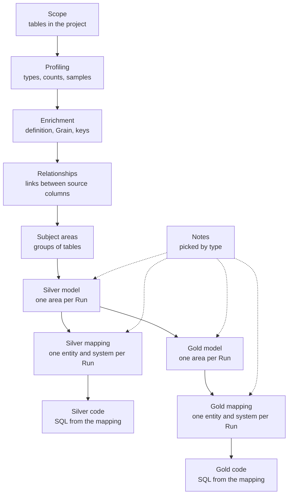

# The whole path

From the tables in scope to SQL, one step at a time. Each step hands its result to the next one.

## Flow

## What each step reads and writes

| Step | Reads | Writes |
|---|---|---|
| Profiling | The scope tables in Databricks | Column types, counts, sample values |
| Enrichment | Profiles, samples | For each table and column: definition, Grain, keys |
| Relationships | Enriched tables, samples | Links between source columns |
| Subject areas | Enriched tables (no samples) | Areas, and which tables are in each |
| Silver model | The area's Bronze tables, related tables, existing entities, Notes | Entities, attributes, sources, notes for mapping, links |
| Silver mapping | One entity and its sources for one system, source table details, parent key facts from the model, Notes | The mapping: an entity part and one line per attribute |
| Silver code | The Silver mapping only | SQL that gives the final data frame |
| Gold model | The area's Silver entities, related Silver entities, existing Gold entities, Notes | Gold entities (Fact or Dimension), attributes, sources, links |
| Gold mapping | One Gold entity and its Silver sources for one system, parent key facts from the model, Notes | The mapping, same two parts |
| Gold code | The Gold mapping only | SQL that gives the final data frame |

## Decided

- A step reads only the step before it, plus Notes.
- Mapping uses only the model as context, never another mapping.
- Code reads only the mapping.
- Gold reads Silver only. It never goes back to Bronze.
- Mapping and code are by source system, in Silver and in Gold, because the pipeline runs by tenant and system.
- Silver and Gold are stored apart: two sets of model tables with the same shape, and two sets of mapping tables.

## Decided when we build it

- Exactly what each Run is given, field by field. This is settled workflow by workflow.
