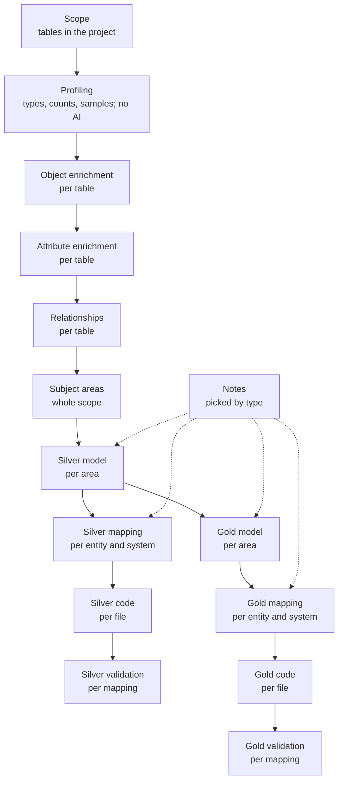

# The whole path

From the tables in scope to SQL and its checks, one step at a time. Each step hands its result to the next one.

## Flow

Profiling measures the tables without AI. The AI then defines the tables and their columns, finds how the tables
link, and groups them into subject areas. For each area it builds the Silver model, and from it the Gold model. Each
entity then gets a mapping, code and validation checks for each of its systems. Every step reads Notes of its own
types ([notes-and-prompt-builder.md](../shared/notes-and-prompt-builder.md)).

Most steps are **one shot**: the AI gets everything in one prompt and answers once. The Silver and Gold models are
**tool based**: the AI works through tools, looking up tables and entities and writing its answer into the ledger
one piece at a time ([run.md](run.md)). Each step has only its one kind of Run, so each has one prompt to maintain.

## What each step reads and writes

| Step | Reads | Writes |
|---|---|---|
| Profiling | The scope tables in Databricks | Column types, counts, sample values |
| Object enrichment | Each table's columns, profiles, samples | Each table's definition and Grain |
| Attribute enrichment | The reviewed table definitions, profiles, samples | Each column's definition, inferred type, key, nullability and personal data marks |
| Relationships | Enriched tables, samples | Links between source columns |
| Subject areas | Enriched tables and their links (no samples) | Areas, and which tables are in each |
| Silver model | The area's Source and Bronze tables, related tables, existing entities, Notes | Entities, attributes, sources, notes for mapping, links |
| Silver mapping | One entity and its sources for one system, source table details, parent key facts from the model, Notes | The mapping: an entity part and one line per attribute |
| Silver code | The applied Silver mappings of the file's systems, and the names and types of the tables they use | SQL that gives the final data frame |
| Silver validation | One applied Silver mapping, its tables and the loaded entity, never the code | Checks for that entity and system |
| Gold model | The area's Silver entities, related Silver entities, existing Gold entities, Notes | Gold entities (Fact or Dimension), attributes, sources, links |
| Gold mapping | One Gold entity and its Silver sources for one system, parent key facts from the model, Notes | The mapping, same two parts |
| Gold code | The applied Gold mappings, and the names and types of the entities they use | SQL that gives the final data frame |
| Gold validation | One applied Gold mapping, its Silver entities and the loaded entity, never the code | Checks for that entity and system |

## Decided

- A step reads only the step before it, plus Notes.
- Mapping uses only the model as context, never another mapping.
- Code reads only the mapping, plus the names and types of the tables it uses. Validation reads the mapping too,
  never the code, so its checks can catch the code's mistakes (Nov 28, Maaz).
- Gold reads Silver only. It never goes back to Bronze.
- Mapping, code and validation are by source system, in Silver and in Gold, because the pipeline runs by tenant and
  system. A code file covers the systems the person picks, one or several.
- Silver and Gold are stored apart: two sets of model tables with the same shape, and two sets of mapping tables.

## Fixed conventions for Silver and Gold

These hold in every model, mapping, code file and check, with no exception (Nov 28, Maaz). They are part of the fixed
guidance in `core/`, so a project's naming instructions cannot change them.

- **Every entity has `SourceSystemID`**, a number, always the last column. The code's SQL fills it from
  `meta.system AS s WHERE s.SystemCode = '<system-code>'`, and the orchestrator adds the other audit columns. Lookups
  and checks match one system's rows the same way. A merged entity has it too: each row holds one of its systems,
  picked the same way on every load.
- **Every entity has exactly one surrogate key**, an auto-incrementing identity column that the load fills. In Silver
  it is named `<Entity>ID`, such as `ContactID`, and in Gold `<Entity>Key`, such as `CustomerKey`.
- **A source column that would get the same name is renamed** `Source<Entity>ID` in Silver and `Source<Entity>Key`
  in Gold, such as Salesforce's contact ID becoming `SourceContactID`.
- **A link attribute is named after its parent's key**, such as `CustomerID` in Silver and `CustomerKey` in Gold,
  and holds the parent's surrogate key.

## Decided when we build it

- The prompt texts for each step.
