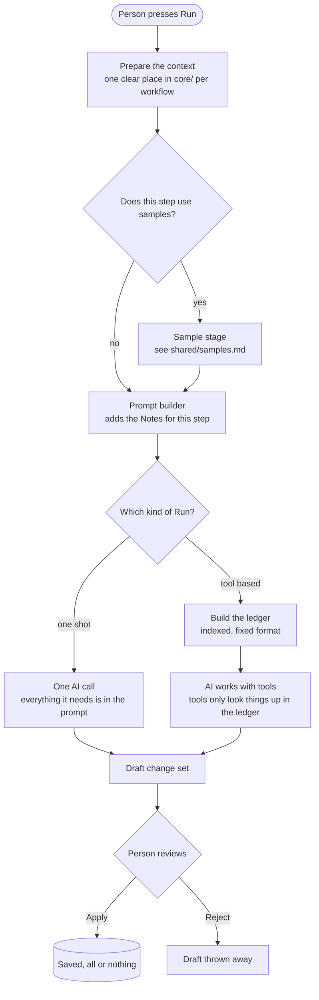

# What happens when you press Run

Every AI step works the same way: prepare the context, call the AI, make a draft, and wait for a person.

## Flow

## Decided

- **Two kinds of Run in the web app, like v2.** One shot: everything is in the prompt. Tool based: Python first
  builds an indexed ledger, and the AI's tools only look things up in it, so answers are quick.
- **VS Code is a third way in.** There the agent uses real MCP tools. It is separate from the web app's tool based Run.
- **All three use the same code underneath.** Nothing is written twice. See [table-details.md](../shared/table-details.md).
- **The two kinds of Run have different prompts.** The tool based prompt also explains the tools.
- **Context preparation for each workflow lives in one clear, easy to find place.**
- **Each stage shows in the Run log.** Fetching samples is its own stage.
- **A locked item cannot be updated or touched by a Run.**
- **Running again is free.** The AI may add or change what it thinks is right, or return nothing.
- **No automatic retries or repair loops.**
- **One Run at a time per tenant.** Runs in different tenants run at the same time. A Run left running for over
  4 hours (the server stopped) is marked failed before the next one starts.
- **Each Run is recorded** with its Run log (one line per stage), its AI usage (tokens and cost per AI call) and the
  draft it made.

## Decided when we build it

- Which tools a tool based Run gets, and their inputs and outputs.
- What a tool based Run starts with, and what goes in the ledger.
- The prompts.
- Where in `core/` each workflow's context preparation lives. Each workflow file will name it.
