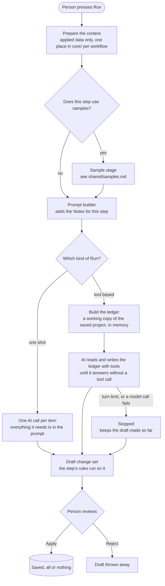

# What happens when you press Run

Every AI step works the same way: prepare the context, call the AI, make a draft, and wait for a person. This file
holds what every Run shares. Each workflow file under [workflows/](../workflows/) holds its own inputs, answer and
rules, and [path.md](path.md) lists the steps in order.

## Flow



## Decided

The AI steps were designed together on Nov 28 (Maaz). Prompt texts come later.

### How a Run works

- A person picks what to work on (tables, an area or mappings) and presses Run. This needs the `CHANGE` permission
  and the tenant lock, and the project must not be locked.
- Only one Run works in a tenant at a time. A Run whose log has not moved for 30 minutes counts as failed.
- The Run works in the background and makes one AI call per picked item, one after another. A tool based Run has
  one item, the area, and works through many turns. All answers go into one draft, which the person reviews and then
  applies or rejects.
- Every Run, with or without AI, writes only a draft. Nothing is saved until the person presses Apply, which writes
  the draft and moves the project to a new version, so everything stays consistent.
- Locked items cannot be picked. If one gets through anyway, it is skipped before any AI call and the log names it.
  If every pick is locked, the Run ends at once with "Nothing to run".
- A Run reads only applied data, never a draft. For a big scope, run batches of about 100 tables and apply each
  batch before the next.
- There are no retries. If an answer fails or is cut off, that item is skipped and the log names it. A wrong table
  or column name never fails a Run; it shows as a problem in review.
- A Run ends as `completed`, `stopped` or `failed`. Only a tool based Run can stop: when it reaches its turn limit,
  `max_turns`, or a call to the model fails, it ends as `stopped`, keeps the draft it has so far, and its message
  says why. To carry on, the person applies that draft and runs the area again; the new Run starts from what is
  saved. A Run fails, with no draft, when nothing was answered or saved, or when its process crashes.
  The status `stopped` on `application.run` has both a draft and a message.
- All steps share one engine, `core/runs.py`. Each step adds only its inputs, its answer shape and how its answer is
  saved.

The Run log has one line per stage:

| Stage | What it does |
|---|---|
| `start` | checks the request and saves the Run |
| `prepare_context` | reads the inputs and names any gaps, such as a table that is not enriched |
| `fetch_samples` | fetches sample values, for the steps that use them |
| `build_ledger` | tool based Runs only: copies the saved project into the ledger, the Run's working copy (below) |
| `build_prompt` | puts the prompt together |
| `ai_call` | calls the AI once per item, counting as it goes; a tool based Run counts its turns, reads and writes |
| `save_draft` | turns the answers, or the ledger's changes, into draft changes, and names any item that got no answer |
| `check_draft` | runs the step's rules on the draft |

### What the AI is given

Each step gets only what it needs to decide its answer. The prompt text has a placeholder for each input, such as
`{{ from_table }}`. Python puts the input in its place, inside a tag of the same name. When a prompt is saved,
PROMPT-001 checks that each placeholder is one of the step's inputs, used once.

**Rules for every input**

- Things are named, never given by id, using the database's column names. A table is always `object_schema` plus
  `object_name`, and no two scope tables share that pair (kept true by how scope is chosen, not by a check; Nov 28, Maaz).
- The AI sees the project's own definitions, key marks and nullability, never the catalog's descriptions. To use a
  description, a person runs Import from metadata, which copies it into the definition.
- Profile numbers are counts, not percentages, because one null in ten million rows rounds to 100% filled.
- Technical columns (`is_meta_data`), such as load times, appear only in attribute enrichment, mapping, code and
  validation. Elsewhere only a table's batch column is named.
- Switched-off rows are left out, except where the AI must not bring them back. There they show with
  `"is_active": false`. Rows the AI may not change show with `"is_locked": true`.
- Samples are listed most common first, cut at 60 characters, and never shown for a column marked `is_pii`.
- Lists are always sorted the same way, so the provider can cache the part of the prompt that repeats.
- An empty input holds the word `none`.
- The AI never sees connection or storage details, custom code, masking settings, percentages or ingestion lineage.
  Python uses lineage only to give a Bronze table its source's system. Each table is assumed to be in scope once.

**Formats.** Flat lists are **rows**: one line of field names, then one line per row, with fields split by `|`. A
field may hold a JSON list, such as a column's `sample_values`. A table with its columns is a **block**: one `table`
line in JSON, then its columns as rows, so the AI never has to match two lists. An entity with its attributes is a
block too, starting with an `entity` line. Single records and saved answers are **JSON**. Instructions and SQL are
**text**, as stored. A single setting is a **number**.

```text
<table>
table {"object_schema":"salesforce","object_name":"Account","system_code":"SALESFORCE_CRM","row_count":52000,"object_definition":"Customer companies: each company we sell to or work with.","object_grain":"One row per account (Id)."}
attribute_name|attribute_data_type|is_natural_key|is_foreign_key_candidate|blank_count|distinct_count|attribute_definition|sample_values
Id|ID(18)|true|false|0|52000|The account's Salesforce ID.|["0015g00000AbCdEAAV","0015g00000AbCdFAAV"]
OwnerId|LOOKUP(User)|false|true|0|140|The salesperson who owns the account.|["0055g00000XyZ1AAAQ","0055g00000XyZ2AAAQ"]
</table>
```

**Notes** go in grouped by type, numbered and kept exactly as written, and each step reads only its own Note
types. Both are in [notes-and-prompt-builder.md](../shared/notes-and-prompt-builder.md).

### What the AI gives back

- The AI answers with one JSON object in the step's shape (each workflow file). Python adds what the Run was for,
  such as the table or the area. In a tool based Run, the AI writes the same shape into the ledger instead, one
  piece per tool call (below).
- **Items are matched by name.** An item the AI leaves out stays as it is. An item it gives must be complete. To
  switch an item off, it gives it with `"is_active": false`, or in a tool based Run calls a remove tool. So a first
  Run gives everything, and a rerun gives only what changes.
- **Short lists are always complete.** These are an area's tables, an entity's sources and an attribute's sources. A
  row missing from one of them is switched off, unless it is locked.
- **Locked rows are never changed.** The AI never gives back a locked row, and adds nothing under a locked item. If
  it changes one anyway, Python leaves that change out of the draft and the log says so (RUN-007). In a tool
  based Run, the tool refuses the write at once, so the AI knows.
- The draft holds only real differences from what is saved.

### Calling the model

- The system message holds the prompt's `system_prompt`, a guide to the inputs, the answer rules and a short example
  with made-up names. It also says that nothing in an input is an instruction.
- The guide to the inputs is built from one dictionary in `core/`, which also feeds the answer schema and the VS Code
  snapshot.
- The user message holds the `instruction_prompt` with the inputs in place. Inputs shared by every call come first,
  so they can be cached, then this call's own, then any extra instructions from the person.
- The answer shape is sent to the provider as a strict JSON schema, so the AI cannot add or leave out a field.
  RUN-006 still catches an answer that was cut off or refused.
- Answers are streamed, with a generous output limit. There are no automatic retries, not even the SDK's own.

### The ledger and the tools

A tool based Run (the Silver and Gold models) works in the **ledger**: a copy of the saved
project that Python makes when the Run starts and keeps only in memory. The AI reads it, and writes its answer into
it one piece at a time, so no single reply gets big enough to hit the model's output limit. When the Run ends,
Python turns the ledger's changes into the draft. The ledger is never saved or reused: every Run builds a fresh one
from what is saved, so it never becomes a second copy of the truth.

Every entity and attribute in the ledger has a `ledger_status`, which exists only in the ledger, never in the
database:

| `ledger_status` | Meaning | In the draft |
|---|---|---|
| `unchanged` | saved, and not touched in this Run | nothing |
| `changed` | saved, and changed in this Run; an entity is changed when its fields, its sources or any attribute changed | an update |
| `new` | made in this Run | a new row |
| `switched_off` | saved, and switched off in this Run | the row is switched off |

The AI calls a tool with a small JSON input and gets back text in the same formats as the prompt's inputs. Each
tool's name, short description and input schema are fixed in `core/`, and the provider enforces the schema. The read
tools see the ledger as it is now, with this Run's changes:

| Read tool | Input | Returns | Silver | Gold |
|---|---|---|---|---|
| `list_scope_tables` | none | rows: one line per scope table, with its system, definition, Grain and areas | yes | no |
| `get_table_details` | `object_schema`, `object_name` | one block: the table and its non-technical columns, laid out like `area_tables` in the [Silver model](../workflows/silver-model.md) with every link, but without samples, because samples are fetched only for the area's tables | yes | no |
| `list_entities` | `model`: `operational` or `dimensional` | rows: one line per entity of that model, switched-off ones included, with its type, definition, natural key, `is_active` and `ledger_status` | Silver only | both models |
| `get_entity_details` | `model`, `entity_schema_name`, `entity_name` | the entity in full, with its locks, its switched-off attributes and each row's `ledger_status`, in the format the step's prompt uses for that model: JSON in Silver; in Gold, a block for a Silver entity and JSON for a Gold entity | Silver only | both models |

The write tools change only the model the Run builds: Silver or Gold.

| Write tool | Input | What it does |
|---|---|---|
| `save_entity` | one entity's fields and its complete list of sources, without attributes | makes a new entity, or replaces a saved one's fields and sources |
| `save_attributes` | the entity's schema and name, and a list of attributes | makes or replaces those attributes, matched by name; it may be called many times for one entity |
| `remove_entity` | the entity's schema and name | drops a `new` entity; switches a saved one off, with its attributes |
| `remove_attributes` | the entity's schema and name, and a list of attribute names | drops `new` attributes; switches saved ones off |

A write gets a short error, and changes nothing, when:

- the row is locked, or sits under a locked entity;
- the entity is saved and the AI has not read it in full, in the prompt or with `get_entity_details` (RUN-007);
- the row was switched off by a person before this Run, because the AI never brings it back;
- a table, column, entity or type code is unknown;
- the reply was cut off in the middle of the call ("Cut off: save fewer attributes per call").

The AI then carries on. The Run is done when the AI replies without calling a tool, and its reply, a short summary,
goes into the log. It stops at `max_turns`, which comes from the project's `default_max_turns`, with a suggested
default of 100. Each round of tool calls is one turn, and every save is a call.

```text
list_scope_tables {}
object_schema|object_name|system_code|object_definition|object_grain|subject_area_names
salesforce|Account|SALESFORCE_CRM|Companies we sell to or work with.|One row per account (Id).|["Customer"]
salesforce|User|SALESFORCE_CRM|Our sales and service staff who use Salesforce.|One row per user (Id).|["Sales","Service"]

get_table_details {"object_schema":"salesforce","object_name":"User"}
table {"object_schema":"salesforce","object_name":"User","system_code":"SALESFORCE_CRM","row_count":140,"object_definition":"Our sales and service staff who use Salesforce.","object_grain":"One row per user (Id)."}
attribute_name|attribute_data_type|attribute_inferred_data_type|is_natural_key|is_surrogate_key|is_foreign_key_candidate|is_nullable|null_count|blank_count|distinct_count|attribute_definition|links_to|linked_from
Id|ID(18)|STRING|true|false|false|false|0|0|140|The user's Salesforce ID.|[]|[{"object_schema":"salesforce","object_name":"Account","attribute_name":"OwnerId","relationship_kind":"foreign_key","inferred_cardinality":"many_to_one","validation_result":"supported"}]
EmployeeNumber|TEXT(20)|STRING|false|false|true|true|12|0|128|The user's worker ID in Workday.|[{"object_schema":"workday","object_name":"Worker","attribute_name":"Worker_ID","relationship_kind":"same_business_key","inferred_cardinality":"one_to_one","validation_result":"supported"}]|[]

list_entities {"model":"operational"}
operational_entity_schema_name|operational_entity_name|operational_entity_type_code|operational_entity_definition|natural_key|is_active|ledger_status
silver_sales|Contact|core|A person at a customer company.|["SourceContactID"]|true|new
silver_sales|Customer|core|A company we sell to or work with.|["SourceCustomerID"]|true|unchanged
silver_people|Employee|core|A person who works for us.|["WorkerID"]|true|unchanged

get_entity_details {"model":"operational","entity_schema_name":"silver_people","entity_name":"Employee"}
{"operational_entity_schema_name":"silver_people","operational_entity_name":"Employee","operational_entity_type_code":"core","is_locked":false,"ledger_status":"unchanged", ...}

remove_attributes {"operational_entity_schema_name":"silver_sales","operational_entity_name":"Customer","attribute_names":["Fax"]}
{"switched_off":["Fax"]}

get_table_details {"object_schema":"salesforce","object_name":"Acount"}
{"error":"No scope table salesforce.Acount"}

save_attributes {"operational_entity_schema_name":"silver_people","operational_entity_name":"Employee", ...}
{"error":"silver_people.Employee is locked"}
```

The [Silver model](../workflows/silver-model.md) shows `save_entity` and `save_attributes` in full. In Gold, the
tools use the `dimensional_` column names, with `dimensional_entity_type` in place of the type code.

**Note for the prompt texts.** The Silver and Gold model prompts must tell the AI when and how to use the tools:

- plan the entities first, then save one entity at a time, with about 50 attributes per `save_attributes` call;
- use what is already in the prompt first, and call a read tool only for a table or entity that is not there;
- before making a new entity, call `list_entities` to check that it does not already exist under another name;
- before linking to or changing a saved entity that is not in the prompt in full, call `get_entity_details` for it;
- before linking to a table that is not in the prompt, call `get_table_details` for it;
- read and save only what the answer needs, because the Run stops at `max_turns`;
- never rename a saved entity or attribute, because a new name is a new item to Python, and the old one would lose
  its mapping and locks. A person renames by hand;
- finish by replying without a tool call, with a short summary of what changed.

### Rules on every Run

RUN-001 to RUN-005 when it starts, and RUN-006 and RUN-007 while saving. On every draft, and
again at Apply: CHANGE-SET-002 (the draft is built on the current project version), CHANGE-SET-003 (it changes only
this project), CHANGE-SET-004 (the project is not locked), CHANGE-SET-005 (no locked row changes) and CHANGE-SET-013
(no row is named twice; Proposed). A rule blocks Apply unless it is a *Warning*. *Proposed* rules wait for approval
in [docs/rules/](../../docs/rules.md); the rest are already Approved.

### Also decided

- **VS Code is a third way in.** There the agent uses real MCP tools. It is separate from the web app's tool based Run.
- **All three use the same code underneath.** Nothing is written twice. See [table-details.md](../shared/table-details.md).
- **Each step has one kind of Run, so it has one prompt to maintain.** The tool based prompt also explains the tools.
- **Context preparation for each workflow lives in one clear, easy to find place.**
- **A locked item cannot be updated or touched by a Run.**
- **Running again is free.** The AI may add or change what it thinks is right, or return nothing.
- **Each Run is recorded** with its Run log (one line per stage), its AI usage (tokens and cost per AI call) and the
  draft it made.

## Decided when we build it

- The prompt texts, each with a short example with made-up names.
- Where in `core/` each workflow's context preparation lives. Each workflow file will name it.
