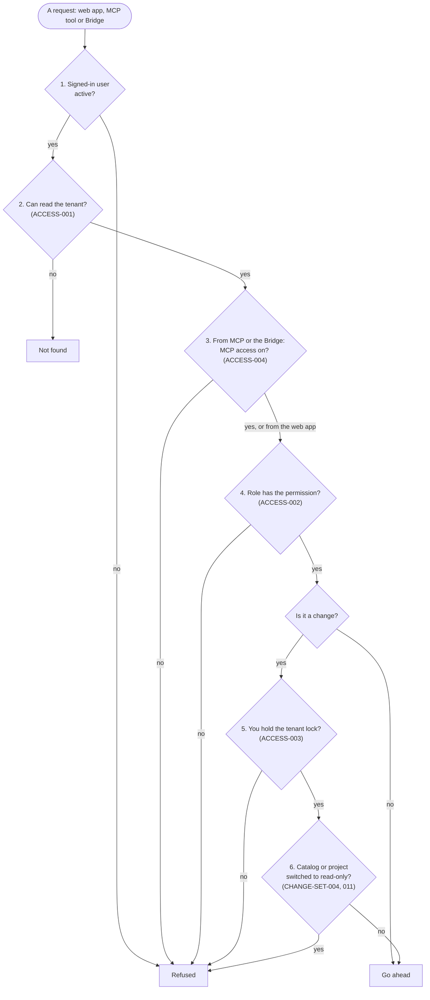

# Access

Who can read and change what, in the web app, the MCP server and the Bridge. One function in `core/` makes every
check, for all three. The rules are in [docs/rules/access.md](../../docs/rules/access.md) and
[docs/rules/change-sets.md](../../docs/rules/change-sets.md).

## Flow



## Decided

**Roles and permissions.** Three roles; each has everything the one before it has. v2's Architect is dropped
(Nov 20, Maaz): Developers change both the catalog and projects. Three permissions (Nov 20, Maaz): taking the
tenant lock is part of `CHANGE`, and catalog and project changes share `CHANGE`, because the same roles have them.
If a role ever needs to change one but not the other, split `CHANGE` in the role map and the routes that use it.

| Permission | What it allows | Viewer | Developer | Tenant Admin |
|---|---|---|---|---|
| `READ` | see the catalog, projects, drafts, Runs and the Run log; MCP reads and Bridge pull | yes | yes | yes |
| `CHANGE` | take and give back the tenant lock; Run, VS Code push, hand edit, Apply and Reject, for project and metadata change sets | | yes | yes |
| `MANAGE_TENANT` | members, roles, MCP access, the catalog lock and project locks (the admin page) | | | yes |

- **Super Admin** counts as a Tenant Admin in every tenant. Still needs the tenant lock to change anything.
- **Global tenant**: anyone signed in is a Viewer there without being a member. A member keeps their own role.
- **No access looks like nothing there**: a tenant you cannot read gives "not found", not "denied". That is why
  the read check (2) comes before the MCP check (3): a refusal would tell an outsider the tenant exists.
- **No end dates**: access lasts until a Tenant Admin removes it. A user or tenant switched off has no access.
- **Every change needs the tenant lock**, held by you, at most 4 hours. Reads never need it.

**Three switches, each on the row it controls** (Nov 20). No separate table: each is one yes/no on the row it
belongs to, and that row's `updated_by` and `updated_time` say who last flipped it. All three are set by a Tenant
Admin on the admin page.

| Switch | Level | Where it is stored | What it does |
|---|---|---|---|
| MCP access | one user in one tenant | `security.tenant_principal_access.mcp_access_enabled` | allows MCP tools and the Bridge for that person in that tenant; needed by every role, Super Admins always have it |
| Catalog lock | tenant | `core.tenant.is_metadata_locked` | makes the tenant's catalog read-only |
| Project lock | project | `project.project.is_locked` | makes one project read-only |

The tenant lock is different: it is not a switch but a short hold (at most 4 hours) one person takes to make
changes, stored in `security.tenant_lock`.

**How `core/` does it.** One function, called first by every web route, MCP tool and Bridge call:

```
require(conn, user, tenant, permission, project=None, via_mcp=False, taking_lock=False)
```

Built in `core/access.py` (step 3a). `conn` is the database connection the app passes in. `taking_lock` is true only
for the call that takes the tenant lock itself.

- `permission` is one of three names: `READ`, `CHANGE`, `MANAGE_TENANT`.
- `via_mcp` says the call came through the MCP server (MCP tools and the Bridge). It is not read from the request:
  the MCP server's code always passes `True` and the web app's code never does. They are two separate programs
  (App Service and the Databricks App), so a caller cannot reach one through the other or fake the flag.
- How `user` is found differs by server: the web app looks you up by the email from the Databricks sign-in, and
  the MCP server by the Microsoft object ID in the token VS Code sends. Both lead to the same `security.principal` row.
- One small map in `core/` says which permissions each role has (the table above). Changing a role means
  changing that map only; no route changes.
- It makes the checks in the order of the flow above, and stops at the first that fails, with that rule's ID:
  1. the user is active;
  2. the user can read the tenant (ACCESS-001), otherwise "not found";
  3. when `via_mcp` is true, MCP access is on (ACCESS-004);
  4. the role has the permission (ACCESS-002);
  5. for `CHANGE`, the user holds the tenant lock (ACCESS-003), except when the call is taking the lock itself;
  6. for `CHANGE` with a project, the project is not locked (CHANGE-SET-004); for `CHANGE` without a project
     (a catalog change), the catalog is not locked (CHANGE-SET-011). Neither applies to taking the lock.
- Routes never check roles or locks themselves; they only call `require`. A route that forgets it is caught by
  a test that every route calls it.
- `MANAGE_TENANT` does not need the tenant lock, so a Tenant Admin can always unlock a project or the catalog.

## Decided when we build it

- The admin page itself.
- Who creates lanes and tenants, and who edits global and tenant prompts.
