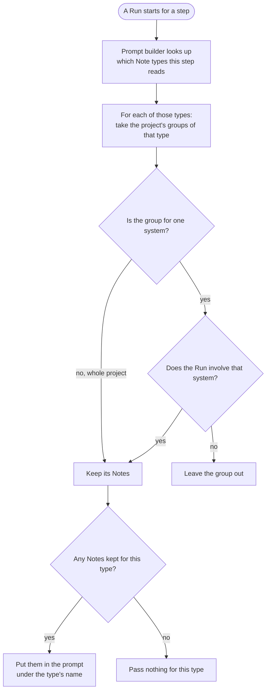

# Notes and the prompt builder

A Note is written knowledge for a project: a requirement, a rule, a decision. The prompt builder decides
which Notes go into which prompt.

## The tables (same as v2)

| Table | Holds |
|---|---|
| `context_type` | The list of Note types. Comes from a seed file. |
| `context_group` | A named group of Notes in a project. Has one type. Is for one system, or for the whole project. |
| `context_record` | One Note: the text. Belongs to a group. |

## Flow



## Which type goes where

In a prompt, Notes use their own **grouped** format: grouped by type, numbered, and kept exactly as written:

```text
<context_records>
<group type="source_information" name="Salesforce facts" system_code="SALESFORCE_CRM">
1. Fields ending in __c are our own custom fields.
2. SAP_Customer_Number__c holds the customer's number in SAP, without leading zeros.
</group>
</context_records>
```

Each step reads only the Note types listed for it below. A group written for one system is included only when
the Run involves that system. Notes of the `agent` type never go into a Run.

| Step | Note types |
|---|---|
| Object and attribute enrichment | `source_information`, `enrichment_requirement` |
| Relationships (`analysis`) | `source_information`, `analysis_requirement` |
| Subject areas | `source_information`, `subject_area_requirement` |
| Silver model | `operational_model_requirement`, `kpi_requirement`, `source_information` |
| Gold model | `dimensional_model_requirement`, `kpi_requirement`, `reporting_requirement` |
| Silver and Gold mapping | `mapping_requirement` |
| Silver and Gold code | `code_requirement` |
| Silver and Gold validation | `validation_requirement`, and `mapping_requirement` for the house standards the code applies |

**Note types added on Nov 28 (Maaz)** in `database/seed/01_context_type.sql`:

| Type | Read by | What it holds |
|---|---|---|
| `source_information` | enrichment to the Silver model | facts about a source system, such as "Fields ending in __c are our own custom fields" |
| `enrichment_requirement` | object and attribute enrichment | how tables and columns should be defined and marked |
| `analysis_requirement` | relationships | rules for finding links, such as "never link on a created-by column" |
| `subject_area_requirement` | subject areas | how the tenant wants tables grouped, such as "keep service cases in their own area" |
| `code_requirement` | code | how the load SQL is written, such as its layout and the batch filter |
| `validation_requirement` | validation | the tenant's own checks, such as "every order has a customer" |

## Decided

- Keep the v2 tables: context group and context record, plus context types from a seed file.
- The prompt builder holds the logic for which types go to which step (the table above, Nov 28, Maaz). It lives in
  one place.
- A group written for one system goes into a Run only when the Run involves that system. A model Run involves the
  systems of its area's tables.
- If a project has no Notes of a type, nothing is passed for it.
- House standards (trim text, how a lookup is joined, the batch filter) are Notes. Naming and audit columns are project settings (`project_config`). A new project
  starts with a set of starter Notes, and the user can change them.

## Decided when we build it

- Which starter Notes a new project gets. Mapping house standards are `mapping_requirement` Notes, and code house
  standards `code_requirement` Notes.
