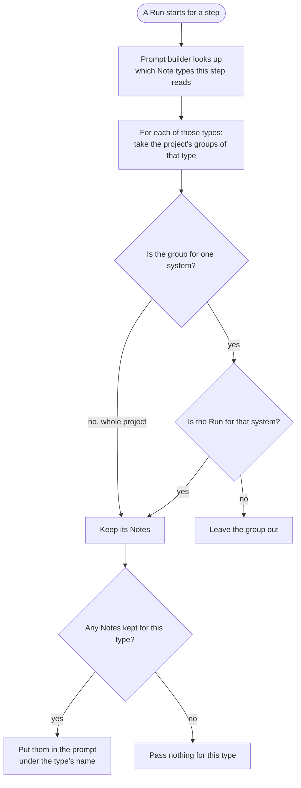

# Notes and the prompt builder

A Note is written knowledge for a project: a requirement, a rule, a decision. The prompt builder decides
which Notes go into which prompt.

## The tables (same as v2)

| Table | Holds |
|---|---|
| `context_type` | The list of Note types. Comes from a seed file. |
| `context_group` | A named group of Notes in a project. Has one type. Is for one system, or for the whole project. |
| `context_record` | One Note: the text. Belongs to a group. |

## Flow

## Which type goes where

These are examples. The final list is the seed file.

| Note type | Read by |
|---|---|
| Silver model requirements | Silver model |
| Gold model requirements | Gold model |
| Mapping requirements | Silver mapping, Gold mapping |
| KPI requirements | Silver model, Gold model |
| Reporting requirements | To be decided |
| Agent | VS Code only. See [agent-notes.md](../vscode/agent-notes.md) |

## Decided

- Keep the v2 tables: context group and context record, plus context types from a seed file.
- The prompt builder holds the logic for which types go to which step. It lives in one place.
- If a project has no Notes of a type, nothing is passed for it.
- House standards (trim text, how a lookup is joined, the batch filter, naming) are Notes. A new project
  starts with a set of starter Notes, and the user can change them.

## Decided when we build it

- The final list of types and which step reads each.
- Which type the starter Notes for house standards use.
- How a group for one system is used by a Run that is not for one system (a model Run).
