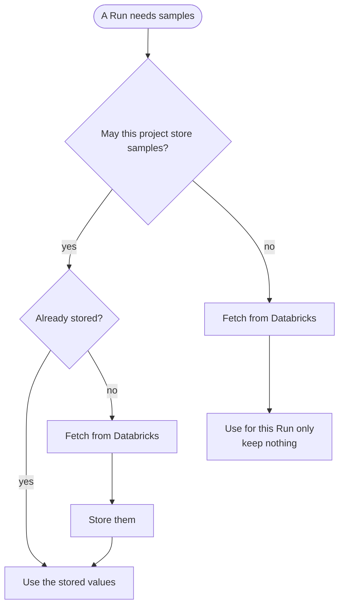

# Sample values

A few real values per column, so the AI can see what the data looks like.

## Flow

## Decided

- **Per column:** up to 5 different non-empty values, most common first.
- **One shared piece of code** fetches samples for every step.
- **Used by** object and attribute enrichment, relationships, the Silver model, mapping and validation (Nov 28,
  Maaz). **Not used by** subject areas, the Gold model or code.
- **In a prompt** they are listed most common first, cut at 60 characters, and never shown for a column marked
  `is_pii`. Once a column is marked `is_pii`, its samples stay out of every later Run.
- **Two project settings:** may samples be stored (some tenants forbid it), and sample size (default 5, maximum 10 set in code).
- **Fetching is its own stage in the Run log.**
- **Stored on the profile:** profiling fetches the samples and keeps them in `attribute_profile.sample_values`
  (a JSON list, most common first) when the project allows it. A later step uses those, or fetches for its
  Run only when none are stored.

## Decided when we build it

- The exact query.
