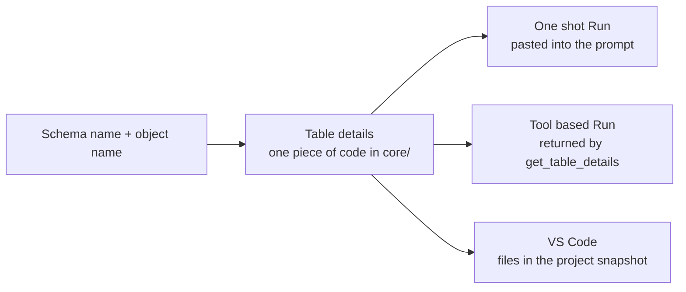

# Table details

One piece of code describes a table. Everything that needs to show a table to the AI uses it.

## Flow

## Decided

- One piece of code, three users. All three see the same details in the same layout.
- A table goes into a prompt as a **block**: one `table` line in JSON, then its columns as rows, so the AI never has
  to match two lists. The layout is in [run.md](../overview/run.md), and each workflow file shows its own.
- For a **related table** (a table outside the subject area at the other end of a link from an area table) the
  details are: definition, Grain, and only its keys and the columns that link, each with name, type, definition and
  key marks. No samples, no profiling numbers (Nov 28, Maaz; this replaces "every column").
- In a prompt, related tables go in their own clearly marked section, so the AI knows they are not part of the area.

## Decided when we build it

- Nothing left: the details for each use are in the workflow files.
