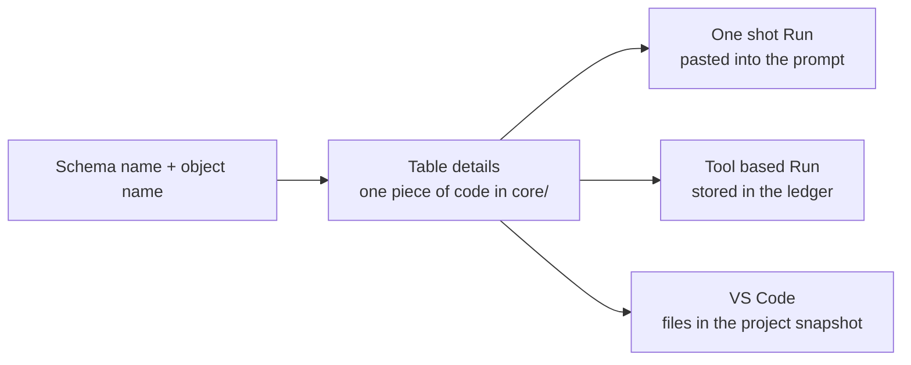

# Table details

One piece of code describes a table. Everything that needs to show a table to the AI uses it.

## Flow

## Decided

- One piece of code, three users. All three see the same details in the same layout.
- For a **related table** (a table outside the subject area that an area table points at) the details are:
  definition, Grain, and every column with name, type, definition and a key mark. No samples, no profiling numbers.
- In a prompt, related tables go in their own clearly marked section, so the AI knows they are not part of the area.

## Decided when we build it

- The full list of details for an area table (samples, profiling, relationships).
- The exact layout of the text.
