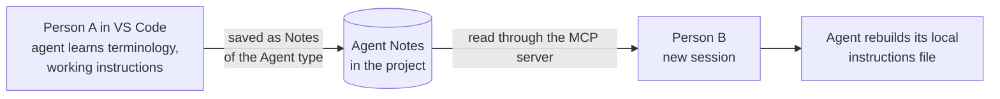

# Agent Notes for VS Code

Shared knowledge for AI sessions in VS Code, kept in one central place, so a new session does not start from nothing.

## Flow

## Decided

- Agent Notes use the same tables as every other Note, with their own type.
- They serve VS Code. Examples: project terminology, or the contents of an agent instructions file.
- Anyone starting a new session gets them out of the box.
- The same Notes tables serve both the web app (through the prompt builder) and VS Code.

## Decided when we build it

- The MCP tool that reads them, and how the agent turns them into a local file.
- How a session saves a new Agent Note. Like every change, it goes through a draft and a person presses Apply.
