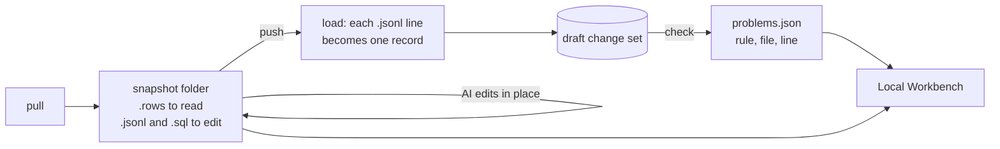

# Bridge: the snapshot folder

What the AI in VS Code pulls, reads, edits and pushes: one folder of files for a project, or for a tenant's metadata.
How pull and push move the files is in `docs/design.md` ("Bridge") and `design/operations/change-sets.md`.

## Flow



## Decided (Nov 28, Maaz)

**Three kinds of file.**

| File | The AI | Holds |
|---|---|---|
| `.rows` | reads | Facts it cannot change: columns, profile counts, samples, overviews. Same rows format as the web Run inputs, built by the same `core/` code |
| `.jsonl` | edits | What it can change, one database row per line |
| `.sql` | edits | SQL code |

The push reads only `.jsonl` and `.sql`. Files starting with `_` are overviews, worked out at the pull.

**Project snapshot.** In the examples ACME is the tenant, Sales the project, SALES_APP a source system and
`sales.orders` one of its tables.

```text
ACME-Sales/
├── gds.json                    project and version, sent back with the push
├── README.md                   the rules, for the AI
├── _overview.rows              every table and subject area, one line each
├── _link-columns.rows          every table's key columns
├── settings.jsonl              project settings
├── scope.jsonl                 the tables in scope
├── subject-areas.jsonl         subject areas and their tables
├── relationships.jsonl         relationships between tables, one file for the project
├── context_records/
│   └── agent.jsonl             one file per context type: its context groups and context records
├── tables/
│   └── sales/
│       ├── orders.rows         columns, counts, samples
│       └── orders.jsonl        definition, Grain, one line per column
├── silver/
│   ├── _entities.rows          every Silver entity, one line each
│   └── silver_sales/
│       └── SalesOrder/         one folder per entity
│           ├── entity.jsonl      the entity, its sources, attributes and links
│           ├── mapping.jsonl     its mapping for each source system
│           ├── validation.jsonl  its validation checks for each source system
│           └── sales_order.sql
├── gold/                       same as silver/
├── snapshot.zip                clean copy, never pushed
└── problems.json               the last check's problems, never pushed
```

**Metadata snapshot.**

```text
ACME-metadata/
├── gds.json
├── README.md
├── _connections.rows                  systems and connections, read only
├── tables/
│   └── ACME.SALES_APP.sales_prod/     one folder per connection
│       ├── _tables.rows               every table, one line each
│       └── sales/
│           └── orders.jsonl           the table, its columns and its lineage
└── operational/                       as in the web app
    └── SALES_APP/
        ├── copy_groups/daily_load.jsonl
        ├── member_groups/companies.jsonl
        └── process_groups/bronze.load_to_bronze.jsonl
```

In metadata the catalog itself is edited, so a table has only a `.jsonl` file. "Operational" here means the copy,
member and process groups, not the Silver model; the README says so.

**An edit file** (`tables/sales/orders.jsonl`, shortened):

```text
{"file":"table","object_schema":"sales","object_name":"orders"}
{"part":"object_enrichment","object_definition":"Orders placed by customers.","object_grain":"One row per order.","is_active":true}
{"part":"attribute_enrichment","attribute_name":"order_number","attribute_definition":"The order's number.","is_pii":false,"is_active":true}
{"part":"attribute_enrichment","attribute_name":"order_date","attribute_definition":null,"is_pii":null,"is_active":true}
```

- Line 1 says what the file is about. Every other line is one database row: `part` is its table, the other fields
  are its exact column names, and other rows are named by names and codes, never ids.
- The pull writes empty lines (`null`) for columns not yet enriched and attributes not yet mapped, for the AI to
  fill in. An empty line changes nothing.
- Removed rows are in the snapshot with `"is_active": false`, so the AI sees them and can bring one back.

**Changes.** A push only creates, updates or switches off; it never removes anything.

| To | The AI |
|---|---|
| Add | adds a line, or fills in an empty one |
| Change | edits the values on the line |
| Switch off | sets `"is_active": false` |
| Bring back | sets `"is_active": true` |

A missing line, field or file changes nothing, everywhere, including an area's tables and an entity's sources
(where web Runs switch missing rows off). So a line a small model drops by mistake loses nothing.

**Names.** Inside a project a table is named by schema and name only. No two scope tables share a schema and name
(SCOPE-005, Approved Nov 28). File names come from the names; a character
a file name cannot hold becomes `_` plus a short code. The server goes by the names inside the files.

**Push.** The load reads every `.jsonl` line as one change set record and takes a code file's SQL from its `.sql`
file. A line it cannot read stops the load, and the error names the file and line. Each problem from the check names
its rule, file and line.

**Local Workbench.** Shows every `.rows` and `.jsonl` file as a table, and the problems from `problems.json`, each
linked to its file and line, as the files are on disk.

## Decided when we build it

- The exact fields of each overview, and the README text (written by the server from the part definitions in `core/`).
- How the Local Workbench reaches the folder.
- Step 4c builds the scope part first: `gds.json`, `README.md`, `scope.jsonl` and the metadata snapshot.
