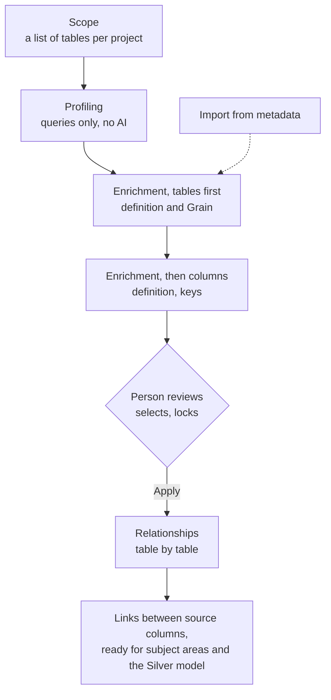

# Profiling, enrichment and relationships

Three steps that describe the source tables before any modeling. Enrichment is two Runs, tables first and then
columns, so column enrichment can use the reviewed table definitions.

## Flow



## Decided

### Object enrichment (`object_enrichment`)

The AI writes each table's definition and Grain (what one row means).

**How it runs.** The person picks scope tables. Each table gets one AI call, with samples, and the answer is saved
to `object_enrichment`. A table whose enrichment is locked is skipped before the AI call.

| Input | Format | What it holds | Why the AI needs it |
|---|---|---|---|
| `systems` | JSON | the tenant and the table's system, such as Salesforce CRM | knowing the system tells the AI that Account is a customer company, not a bank account |
| `context_records` | grouped | `source_information` and `enrichment_requirement` for the table's system | what the tenant knows about that system, and how it wants tables defined |
| `table` | block | the table and its non-technical columns, with counts and samples | names, definitions and samples say what it holds; a column with a different value on every row (such as Account.Id) points to the Grain |

**Reruns.** The saved definition and Grain are in `table`, and the AI gives back good text word for word. It
rewrites a definition only when it lists names instead of saying what the table holds ("Table with Id, Name and
OwnerId"), describes how the data is loaded ("Raw copy of the Account object, loaded daily"), or guesses ("Probably
holds customer information").

**What it gives back.** Either field may be `null` when the AI has nothing to propose, and the log names those
tables. The Grain names its key columns in brackets.

```json
{"object_definition": "Customer companies: each company we sell to or work with.",
 "object_grain": "One row per account (Id)."}
```

**Rules.** ENRICHMENT-001: the table is an active scope table.

### Attribute enrichment (`attribute_enrichment`)

The AI defines each column, works out the data type its values really have, and marks its keys, foreign key
candidates, nullability and personal data.

**How it runs.** As in object enrichment, with one AI call per table covering all its columns. The answer is saved to
`attribute_enrichment`. A table whose columns are all locked is skipped before the AI call. Locked columns are still
shown, marked locked, because the AI needs every column to understand the table. It never gives a locked column back,
and Python drops any change to one.

**Table change.** `attribute_enrichment` gets `is_surrogate_key` and `is_foreign_key_candidate`. It drops
`is_primary_key`, because the primary key is the surrogate key or else the natural key. It keeps
`attribute_inferred_data_type`, which the AI fills. The catalog's `core.attribute` drops its own copy of the
inferred type and keeps only the source's declared `attribute_data_type`, so the inferred type lives only in the
project.

| Input | Format | What it holds | Why the AI needs it |
|---|---|---|---|
| `systems` | JSON | the tenant and the table's system | as in object enrichment |
| `context_records` | grouped | `source_information` and `enrichment_requirement` for the table's system | keys and personal data the tenant already knows about, and how it wants columns defined |
| `table` | block | the table with its reviewed definition and Grain, and every column with counts, lengths and samples; technical columns (the ones the load adds, such as a load time) are marked | a column with a different value on every row is likely a key; samples show running numbers (surrogate key), business IDs (natural key), IDs of other records (foreign key candidate) and names or emails (personal data) |

**Reruns.** The AI gives back only the columns that still have an empty mark and the ones it changes. Good
definitions stay word for word, as in object enrichment.

**What it gives back.** A list of `columns`:

| Field | What it holds |
|---|---|
| `attribute_name` | the column |
| `attribute_definition` | what the column holds |
| `attribute_inferred_data_type` | the type the values really have, written as a Databricks type |
| `is_natural_key` | the column identifies the record in business terms, such as Contact.Id; several columns can form one key |
| `is_surrogate_key` | a key with no business meaning, such as a running number |
| `is_foreign_key_candidate` | the column points at another record, such as Contact.AccountId pointing at an Account |
| `is_nullable` | the column may be empty |
| `is_pii` | the column holds personal data |

The AI works the inferred type out from the source type, the samples and the lengths. The prompt asks for a
Databricks type, such as `STRING`, `INT`, `DECIMAL(16,2)`, `DATE` or `TIMESTAMP`. For example, a text column whose
values all look like `2024-01-31` is a `DATE`, and a Salesforce `CURRENCY(16,2)` column is a `DECIMAL(16,2)`. This is
guidance, not a rule: the field is free text, and no check limits it. The AI gives `null` when it cannot tell.

A mark can be `true`, `false` or `null`, and `null` keeps the saved value. A technical column always gets `false`
for the three key marks, even when it looks unique, because it describes the load and not the business data.

```json
{"columns": [
  {"attribute_name": "AccountId", "attribute_definition": "The company the contact works at.",
   "attribute_inferred_data_type": "STRING", "is_natural_key": false, "is_surrogate_key": false, "is_foreign_key_candidate": true,
   "is_nullable": true, "is_pii": false},
  {"attribute_name": "Email", "attribute_definition": "The contact's work email address.",
   "attribute_inferred_data_type": "STRING", "is_natural_key": false, "is_surrogate_key": false, "is_foreign_key_candidate": false,
   "is_nullable": true, "is_pii": true}]}
```

**Rules.** ENRICHMENT-001: each column is an active column of the table.

### Relationships (`analysis`)

The AI finds the links between scope tables: which column points at which key.

**How it runs.** The person picks scope tables, all of them or batches of about 100. Each table gets one AI call,
with samples, which proposes only the links that start in that table. The answer is saved to `analysis_result`, one
row per pair of columns. If no key is marked anywhere in scope, there is nothing to point at, and the Run ends with
that message.

| Input | Format | What it holds | Why the AI needs it |
|---|---|---|---|
| `systems` | JSON | the tenant and every system in scope | a link can cross systems |
| `context_records` | grouped | `source_information` and `analysis_requirement` | facts ("Account.SAP_Customer_Number__c holds the customer's number in SAP") and rules ("never link on a created-by column") |
| `to_tables` | blocks | every scope table, this one included, with only the columns marked as natural key, surrogate key or foreign key candidate in attribute enrichment, and a few stored samples | the columns a link may point at; types and samples show whether formats match (`0000012345` against `12345`) |
| `from_table` | block | the Run's table, without technical columns, with counts and samples | links start here, usually at a foreign key candidate |
| `relationships_from_this_table` | rows | the saved links that start in this table, with their validation counts, switched-off ones included | the AI may keep, change or switch these off; a switched-off link was rejected by a person |
| `relationships_to_this_table` | rows | the saved links from other tables that point at this table | read only, so the AI does not add the same pair the other way round |

Every call sees every table's keys and foreign key candidates, so batches find the same links as one big Run. A
table with no key marked cannot be pointed at, and the log names it.

**Reruns.** The AI leaves unchanged links out. To move a link, it gives the new one and switches the old one off. It
switches off a link whose column or key has gone, and never brings back a link a person switched off.

**When a table is added to scope**, the links into it come from the tables that point at it. So the Run page offers
to rerun those tables in one click ("Rerun for links: Contact, Case, Opportunity").

**What it gives back.** A list of `relationships`:

| Field | What it holds |
|---|---|
| `from_attribute_name` | the column in this table |
| `to_object_schema`, `to_object_name`, `to_attribute_name` | the column it points at |
| `relationship_kind` | one of the four kinds below |
| `inferred_cardinality` | `one_to_one`, `many_to_one`, `one_to_many`, `many_to_many` or `unknown` |
| `is_active` | `false` only to switch a saved link off |

| Kind | Meaning | Example | What the Silver model does with it |
|---|---|---|---|
| `foreign_key` | a row refers to another record, or to a row of its own table | Contact.AccountId → Account.Id; an organization's parent organization | a link from one entity to its parent entity |
| `extension` | a table only adds more columns to another table's rows, one row for one row, with the same key | an Account extension table → Account.Id | folds both tables into one entity |
| `same_business_key` | both rows are the same real thing in two systems | Account.SAP_Customer_Number__c → the customer number in SAP | one entity fed by both systems |
| `same_code_list` | two columns hold codes from the same list, and no code table is in scope | Account.BillingCountry and a country code in SAP | one shared code entity, such as Country |

- A link goes from the referring column to the column it points at. When both ends are keys, it goes from the table
  that sorts first.
- When a reference uses two columns (an order line points at an order by order number and line number), the AI
  gives one link for each.
- For the cardinality, a side is "one" when its values are unique within one load. The AI answers `unknown` when a
  side is not profiled.

```json
{"relationships": [{"from_attribute_name": "AccountId", "to_object_schema": "salesforce",
  "to_object_name": "Account", "to_attribute_name": "Id", "relationship_kind": "foreign_key",
  "inferred_cardinality": "many_to_one", "is_active": true}]}
```

**Rules.** RELATIONSHIP-001: both ends are active columns of scope tables, and different columns.
RELATIONSHIP-002: two columns are linked at most once. CHANGE-SET-012: the kind and the
cardinality come from their lists.

**Relationship validation** is a separate Run, with no AI, that a person may run after analysis is applied, as in
v2. For each active link it runs a query on Databricks and works out these results:

- `validation_result`: `supported` when every filled "from" value is found in the target and the target values are
  unique, `unsupported` when not, and `inconclusive` when one side has no values;
- `validation_source_missing_target_count`: the "from" values not found in the target;
- `validation_duplicate_target_key_count`: the target values that appear more than once;
- `validation_unused_target_count`: the target values nothing points at.

Like every Run, it writes a draft, and the results are saved when the person presses Apply. They never block a
link. They help a person review it, and later Runs read them.

### Also decided

- **Scope** is the same as v2: a list of tables per project.
- **Profiling** works the same as v2, for the plugin and for the workflows. It has no AI.
- **Enrichment** works as v2: tables first, then columns, with selection and locks, saved per project.
- **Definition and Grain are two separate fields.** The definition is a normal data dictionary definition.
  Grain says what one row means.
- **Import from metadata.** Instead of running the AI, a person can fill enrichment from the catalog. It copies
  descriptions into empty definitions, true key marks into empty marks, and the declared data type, as it is, into
  an empty inferred type. It never copies nullability.
- Enrichment and relationships use sample values. See [samples.md](../shared/samples.md).

## Decided when we build it

- Profiling's own steps, written out and approved before code.

## Built (Nov 28)

- Enrichment is `core/enrichment.py` (its context is prepared there), with the starter prompts
  `database/seed/prompts/object_enrichment.md` and `attribute_enrichment.md`.
