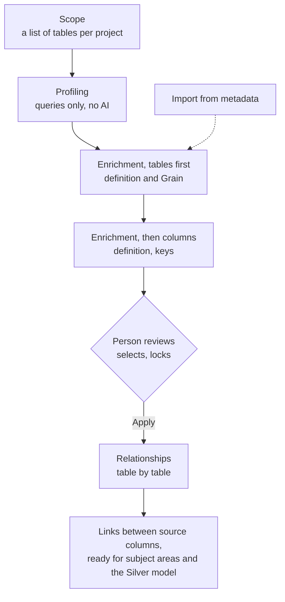

# Profiling, enrichment and relationships

Three steps that describe the source tables before any modeling. They work the same as v2.

## Flow

## Decided

- **Scope** is the same as v2: a list of tables per project.
- **Profiling** works the same as v2, for the plugin and for the workflows.
- **Enrichment** works as v2: tables first, then columns, with selection and locks, saved per project,
  and import from metadata.
- **Relationships** works as v2: table by table.
- **Definition and Grain are two separate fields.** The definition is a normal data dictionary definition.
  Grain says what one row means.
- Enrichment and relationships use sample values. See [samples.md](../shared/samples.md).

## Decided when we build it

- The steps of each of the three workflows, written out and approved before code.
