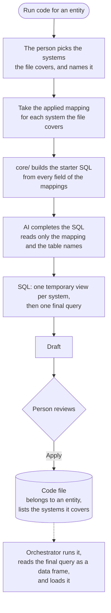

# Code

The AI writes the SQL for an entity, reading only the applied mapping. The SQL gives the final data frame.
Loading it is the orchestrator's job.

## Flow



## Decided

### The Run (`operational_code`, `dimensional_code`)

The AI turns applied mappings into the SQL for one code file. The SQL only gives the final rows. Loading them, with
the merge, history, surrogate key and the other audit columns, is the orchestrator's job.

**How it runs.** The person picks an entity and the systems the file covers, one or several, and names the file or
keeps the suggested name, such as `employee_workday_hr.sql`. Python does not choose for them. It is one shot, with
no samples and no tools, because the mappings already fix everything the SQL may touch: one AI call per file. The
SQL is saved to `*_code` and `*_code_system`. The Run is refused if a picked mapping is not applied, or the file is
locked.

**The starter.** Before the AI call, `core/` builds a starter SQL from the applied mappings, so the AI fills in gaps
instead of starting from nothing, and cannot drop, rename or reorder a column. It carries every field of every
mapping, and a test checks that each field's text shows up in it:

- a comment at the top with the entity's name, Grain, `is_merged` and history;
- one temporary view per system, named `temp_<entity>_<system>`, with the mapping part's transformation as a
  comment at its top;
- the column list in load order, each with its type as a comment and its mapping line in brackets, and
  `SourceSystemID` last;
- the FROM and JOINs from the mapping's sample query, and the row filter in brackets in the WHERE;
- the batch filter on the driving table, the first table after FROM;
- an attribute with no mapping line, already written as the placeholder below;
- the final SELECT: the one view as it is, or for several views, UNION ALL for a normal entity and
  `[combine the views as the mappings say]` for a merged one.

**Fixed rules for the SQL.** These are built in, with no exception:

- `SourceSystemID` is always the last column: `sys.SystemID AS SourceSystemID`, with
  `LEFT JOIN meta.system AS sys ON sys.SystemCode = '<system-code>'`.
- The driving table is filtered with `:batch_id`. Every other Source or Bronze table with a batch column is joined
  on its batch column as well as its keys, such as `AND p.batch_id = w.batch_id`. Silver and Gold tables are joined
  on the natural key only, never on a batch.
- A CAST is added only when the mapping line asks for one.
- When there is no mapping line, or the AI cannot tell how to write a column, the column becomes a placeholder that
  a person cannot miss: `CAST(NULL AS <type>) AS <name> -- NOT MAPPED: <reason>`. A column the AI can write never
  gets one.

| Input | Format | What it holds | Why the AI needs it |
|---|---|---|---|
| `context_records` | grouped | `code_requirement` | layout and house standards |
| `systems` | JSON | the tenant and the systems this file covers | one view per system, each with its `meta.system` lookup |
| `starter_sql` | text | the starter above | the SQL to complete |
| `sql_tables` | blocks | every table and entity the mappings use, by alias within each system, with the names SQL uses (one function in `core/` decides them), each column's type and the batch column marked | real names and types, and which tables have a batch |
| `existing_code` | text | the file's current SQL, or `none` | a rerun updates it to match the starter |

**Reruns.** A rerun gets the starter from the current mappings and the file's current SQL, and updates the SQL to
match, keeping hand changes that still fit.

**What it gives back.** The complete SQL: one temporary view per system, then one final SELECT. For Workday
Employee, where Workday's batch column is `batch_id`:

```sql
CREATE OR REPLACE TEMPORARY VIEW temp_employee_workday_hr AS (
    SELECT
        w.Worker_ID AS WorkerID,
        w.Hire_Date AS HireDate,
        jp.JobProfileID AS JobProfileID,
        CAST(NULL AS BOOLEAN) AS IsContractor, -- NOT MAPPED: no mapping line
        sys.SystemID AS SourceSystemID
    FROM workday.Worker AS w
    LEFT JOIN workday.Position AS p
        ON p.Position_ID = w.Position_ID
        AND p.batch_id = w.batch_id
    LEFT JOIN meta.system AS sys
        ON sys.SystemCode = 'WORKDAY_HR'
    LEFT JOIN silver_people.JobProfile AS jp
        ON jp.SourceJobProfileID = p.Job_Profile_ID
        AND jp.SourceSystemID = sys.SystemID
    WHERE w.batch_id = :batch_id
);
SELECT WorkerID, HireDate, JobProfileID, IsContractor, SourceSystemID
FROM temp_employee_workday_hr;
```

**Note for the prompt texts.** The mapping prompt has a worked example of a mapping, and the code prompt a worked
example of a mapping with the code written from it, both with made-up names.

**Rules.** CODE-001 *(Warning)*: a system is in only one of the entity's code files. CODE-002: the SQL
is read-only, holds only temporary views and one final SELECT, and parses as Databricks SQL. CODE-003 *(Warning)*:
the final SELECT returns every attribute except the surrogate key, by name, with `SourceSystemID` last.
CODE-004 *(Warning)*: a column is left as a NOT MAPPED placeholder.

### Also decided

- **The AI writes the code** from the starter SQL that `core/` builds.
- **Code reads only the mapping,** plus the names and types of the tables it uses.
- **The SQL only gives the final data frame.** It has one temporary view per system, and the last query is what gets
  read.
- **The orchestrator decides how to load it** (merge, replace, keep history). Most of the time it is a merge
  on the natural key. So an entity has no "how it is loaded" field.
- **The orchestrator replaces the batch ID at run time** (`:batch_id`).
- **Stored like v2.** A code file belongs to an entity and lists the systems it covers. So it can be one file
  for all systems, or one file per system, as the person picks.

## Decided when we build it

- The prompt text, and which house standard Notes it is given.
