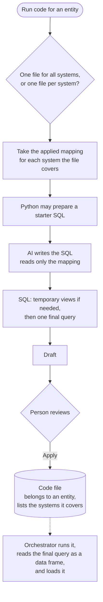

# Code

The AI writes the SQL for an entity, reading only the applied mapping. The SQL gives the final data frame.
Loading it is the orchestrator's job.

## Flow

## Decided

- **The AI writes the code.** Python may prepare a starter SQL and hand it to the AI.
- **Code reads only the mapping.**
- **The SQL only gives the final data frame.** It may have several temporary views, but the last query is what gets read.
- **The orchestrator decides how to load it** (merge, replace, keep history). Most of the time it is a merge
  on the natural key. So an entity has no "how it is loaded" field.
- **The orchestrator replaces the batch ID at run time.**
- **Stored like v2.** A code file belongs to an entity and lists the systems it covers. So it can be one file
  for all systems, or one file per system.

## Decided when we build it

- What the starter SQL looks like.
- The prompt, and which house standard Notes it is given.
