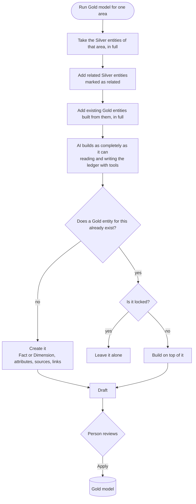

# Gold model

One Run builds the Gold entities (Facts and Dimensions) for one subject area, from the Silver model.
It works the same way as the Silver model, one layer up.

## Flow

## Decided

### The Run (`dimensional`)

The AI builds the Gold model for one subject area: its facts and dimensions, built only from Silver entities.

**How it runs.** As in the [Silver model](silver-model.md): one area, a tool based Run working in the ledger, but
without samples. The read tools see both models, for example to find the date dimension, and the write tools write
only Gold. The draft changes the `dimensional_` tables. The Run is also refused when the area has no Silver entities
yet ("Run the Silver model for Sales first").

**Table change.** `dimensional_entity` gets `is_merged`, and `dimensional_attribute` drops `is_audit_column`.

| Input | Format | What it holds | Why the AI needs it |
|---|---|---|---|
| `dimensional_schemas`, `dimensional_naming_instructions`, `dimensional_audit_columns`, `dimensional_entity_scd_type`, `operational_entity_scd_type` | rows and text | as in Silver, plus whether Gold and Silver keep history | as in Silver; with history, a fact's link must find the dimension row that was valid on the fact's date |
| `context_records` | grouped | `dimensional_model_requirement`, `kpi_requirement` and `reporting_requirement` | grains and shared dimensions, the measures facts must carry, and what reports slice by |
| `subject_area` | JSON | the area's name and definition | the focus of the Run |
| `operational_entities` | blocks | the Silver entities built from the area's tables, with all their attributes | Gold's only sources |
| `related_operational_entities` | blocks | the Silver entities one link away from those | shared dimensions such as Customer often come from outside the area |
| `existing_dimensional_entities` | JSON | in full, the Gold entities built from the area's Silver entities, as the ledger holds them when the Run starts | the AI builds on them |
| `related_dimensional_entities` | rows | one line per Gold entity built from the related Silver entities, as `list_entities` gives it | the AI links to DimCustomer and never makes a second one |

**First area.** Facts sit at the line grain, with the header as a second source for dates and the customer. There is
one dimension per subject, with small reference entities folded in. Dates come from the lake's calendar table, which
Silver models.

**Later areas and reruns.** The AI links to the shared dimensions, extends existing ones under their saved names, and
saves only what changes.

**What it writes.** The same tools and fields as Silver, with `dimensional_` names. Each entity has a
`dimensional_entity_type` of `fact` or `dimension` in place of a type code. Its sources are Silver entities, and an
attribute's sources are Silver attributes. Python adds the same as in Silver, and the load order is the same
separate step.

- A measure's definition gives its meaning, its unit and whether it can be summed. A ratio or year-to-date KPI is not
  an attribute; its parts are.
- A link's source is the Silver link, such as SalesOrder.CustomerID. Its note says to find the dimension row by the
  Silver parent's natural key.

**Rules.** DIMENSIONAL-001 (sources are Silver entities), DIMENSIONAL-002 (attribute sources come from the entity's
sources) and DIMENSIONAL-003 (a link points at an active entity). Also DIMENSIONAL-004 to 007,
DIMENSIONAL-008 *(Warning)* (sources point at active Silver rows), DIMENSIONAL-009 and 010 *(Warnings)*, PROJECT-001
and CHANGE-SET-012 (`fact` or `dimension`).

### Also decided

- **One area per Run, same as Silver.** No separate grouping for Gold.
- **Gold reads Silver only.** A Gold source points at a Silver entity or attribute, never at Bronze.
- **Same rule as Silver:** build fully, and the next Run builds on top.
- **A Gold entity has a kind:** Fact or Dimension.
- **Any link is allowed.** A Fact or a Dimension can point at any Gold entity, including itself. The user decides, not the system.
- **Two sets of tables, Silver and Gold, with the same shape.**
- Notes for mapping, the natural key mark and locks work as in the [Silver model](silver-model.md).

## Decided when we build it

- The prompt text, with its notes on using the tools ([run.md](../overview/run.md)).
