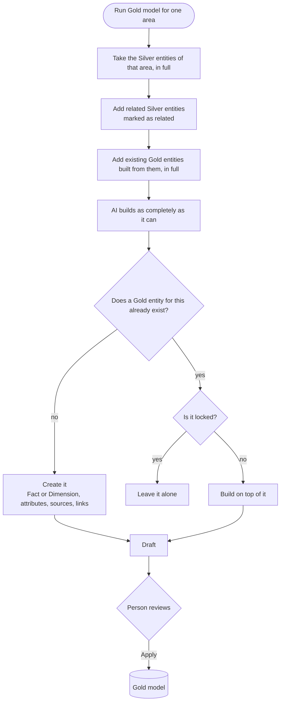

# Gold model

One Run builds the Gold entities (Facts and Dimensions) for one subject area, from the Silver model.
It works the same way as the Silver model, one layer up.

## Flow

## Decided

- **One area per Run, same as Silver.** No separate grouping for Gold.
- **Gold reads Silver only.** A Gold source points at a Silver entity or attribute, never at Bronze.
- **Same rule as Silver:** build fully, and the next Run builds on top.
- **A Gold entity has a kind:** Fact or Dimension.
- **Any link is allowed.** A Fact or a Dimension can point at any Gold entity, including itself. The user decides, not the system.
- **Two sets of tables, Silver and Gold, with the same shape.**
- Notes for mapping, the natural key mark and locks work as in the [Silver model](silver-model.md).

## Decided when we build it

- Exactly what the Run is given for each Silver entity.
- Tools and prompts for the tool based Run.
