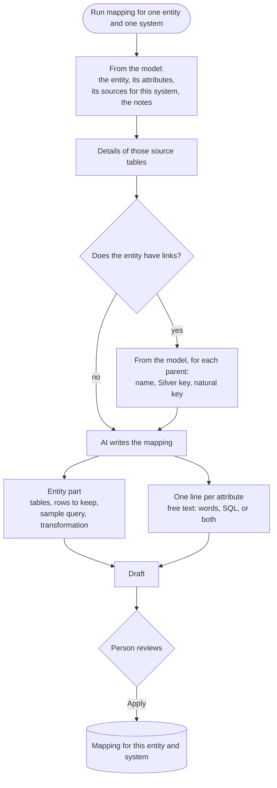

# Mapping

One Run writes the mapping for one entity and one source system. The mapping is a document a developer
could write the code from. Silver mapping reads the Source and Bronze tables. Gold mapping reads Silver.

## Flow



## Example: filling a link

- Bronze `kics_user_device_v1` has `tracking_system_user_id` = "U123", the source's own user number.
- Silver `User` has `UserID` = 501 (the Silver key) and `UserNumber` = "U123" (the natural key).
- Silver `UserDevice.UserID` must hold 501, not "U123".

The mapping line says: look up Silver `User` where `UserNumber` matches `tracking_system_user_id`, and take its `UserID`.

```sql
LEFT JOIN meta.system AS sys ON sys.SystemCode = '<system-code>'
LEFT JOIN silver.User u ON u.UserNumber = ud.tracking_system_user_id AND u.SourceSystemID = sys.SystemID
-- UserID = u.UserID
```

User keeps one row per system, so the lookup also matches `SourceSystemID` (see Lookups below).

The three facts about the parent (name, Silver key, natural key) come from the **model**. In v2 they came
from the parent's own mapping, which was usually not saved yet, so the line was left blank.

## Decided

### The Run (`operational_mapping`, `dimensional_mapping`)

The AI writes how one system loads one entity: which rows to keep, how the tables join, and how each attribute is
built. It is a document a developer could write the code from, and the code step ([code.md](code.md)) turns it into SQL.

**How it runs.** The person picks an entity and a system, or several mappings, which run one after another. Python
fills in the table list: this system's source tables for the entity, plus the Silver parent entity behind each
link. The Run page shows the list, and the person may add or remove a table, such as a code table the AI should
use, then presses Run. It is one shot, with samples: one AI call per mapping. An entity with more than 100
attributes is split into calls of 100 attributes each. The answer is saved to `*_object_mapping` and
`*_attribute_mapping`. The Run is refused if the entity is switched off, has no source in this system, or its
mapping is locked.

**Every mapping is for one system, merged entities too.** A mapping says how this one system loads the entity. When
several systems load the same entity, each has its own mapping, and the code step combines them. For a merged
entity, the mapping part's transformation says so, such as "Country is merged: rows from every system are combined
by CountryCode", so the code knows it must handle it.

**Table change.** `*_object_mapping_tables` becomes a JSON list of tables and entities, each with an alias.

**What it is given.** Two rules shape the inputs. Everything about one attribute sits in one row, and tables are
named by the alias the SQL will use. Audit columns are not shown, because the load fills them and the fixed
conventions say how.

| Input | Format | What it holds | Why the AI needs it |
|---|---|---|---|
| `context_records` | grouped | `mapping_requirement` | house standards, such as "lookups are LEFT JOINs, trim both sides" |
| `systems` | JSON | the tenant and this system | lookups find this system in `meta.system` by its `SystemCode` |
| `target_entity` | block | an `entity` line, then one row per attribute: its type, marks, sources and parent by alias, its note, whether this call maps it, and its saved line and lock | everything the AI needs for one line is in its row |
| `mapping_tables` | blocks | one block per table or entity on the list, each with its alias and role | the only tables it may use, and how they join |
| `existing_mapping_part` | JSON | the saved mapping part with its lock, or `none`; when the entity is split, later calls get the first call's part here and keep it | a rerun builds on it, and a split keeps one set of joins |

In `target_entity`, `map_in_this_call` is `false` for the surrogate key, which has no line, and for attributes left
to another call when the entity is split. `saved_line` holds the attribute's saved line, or `null`.

Each block in `mapping_tables` has a role:

| Role | What it is | What it shows |
|---|---|---|
| `source` | a source table of the entity in this system; in Gold, a Silver source entity | the entity's source note for it, and every column, technical ones marked, with counts, samples and links; in Gold, every attribute with its `link_to` |
| `lookup` | the parent entity behind a link | only its two keys; the natural key's row lists where its value came from (table, column, system, type and 3 stored samples) with its note |
| `added` | a table the person added, such as a code table | the same as a source |

Links sit on the columns, as in the Silver model, but only those between items on the list, plus those to the columns a
lookup's natural key comes from. A link names its other end by alias when it is on the list, and by full name
otherwise. For Silver Employee from Workday:

```text
<target_entity>
entity {"operational_entity_schema_name":"silver_people","operational_entity_name":"Employee","operational_entity_definition":"A person who works for us.","operational_entity_grain":"One row per worker per system.","is_merged":false,"scd_type":"type_1"}
operational_attribute_name|operational_attribute_data_type|is_surrogate_key|is_natural_key|is_nullable|sources|operational_attribute_source_note|link_to|map_in_this_call|saved_line|is_locked
EmployeeID|BIGINT|true|false|false|[]|null|null|false|null|false
WorkerID|STRING|false|true|false|[{"alias":"w","attribute_name":"Worker_ID"}]|As is.|null|true|null|false
HireDate|DATE|false|false|false|[{"alias":"w","attribute_name":"Hire_Date"}]|As is.|null|true|null|false
JobProfileID|BIGINT|false|false|true|[{"alias":"p","attribute_name":"Job_Profile_ID"}]|Look up JobProfile by the position's job profile ID.|jp|true|null|false
IsContractor|BOOLEAN|false|false|false|[{"alias":"w","attribute_name":"Worker_Status"}]|True for contractors.|null|true|null|false
</target_entity>

<mapping_tables>
table {"alias":"w","role":"source","object_schema":"workday","object_name":"Worker","system_code":"WORKDAY_HR","row_count":5200,"object_definition":"Employees and contractors.","object_grain":"One row per worker (Worker_ID).","operational_entity_source_note":"All rows."}
attribute_name|attribute_data_type|is_natural_key|is_meta_data|is_nullable|null_count|blank_count|distinct_count|attribute_definition|sample_values|links_to|linked_from
Worker_ID|TEXT|true|false|false|0|0|5200|The worker's Workday ID.|["21001","21002"]|[]|[]
Hire_Date|DATE|false|false|false|0|0|1900|The day the worker started.|["2019-03-04","2021-11-15"]|[]|[]
Position_ID|TEXT|false|false|true|40|0|5160|The position the worker fills.|["P-1044","P-2310"]|[{"alias":"p","attribute_name":"Position_ID","relationship_kind":"foreign_key","inferred_cardinality":"many_to_one","validation_result":"supported"}]|[]
Worker_Status|TEXT|false|false|false|0|0|3|Active, On Leave or Terminated.|["Active","On Leave","Terminated"]|[]|[]

table {"alias":"p","role":"source","object_schema":"workday","object_name":"Position","system_code":"WORKDAY_HR","row_count":6100,"object_definition":"Positions in the organization, filled or open.","object_grain":"One row per position (Position_ID).","operational_entity_source_note":"Only to reach the job profile."}
attribute_name|attribute_data_type|is_natural_key|is_meta_data|is_nullable|null_count|blank_count|distinct_count|attribute_definition|sample_values|links_to|linked_from
Position_ID|TEXT|true|false|false|0|0|6100|The position's Workday ID.|["P-1044","P-2310"]|[]|[{"alias":"w","attribute_name":"Position_ID","relationship_kind":"foreign_key","inferred_cardinality":"many_to_one","validation_result":"supported"}]
Job_Profile_ID|TEXT|false|false|true|300|0|410|The position's job profile.|["JP-031","JP-118"]|[{"object_schema":"workday","object_name":"Job_Profile","attribute_name":"Job_Profile_ID","relationship_kind":"foreign_key","inferred_cardinality":"many_to_one","validation_result":"supported"}]|[]

entity {"alias":"jp","role":"lookup","operational_entity_schema_name":"silver_people","operational_entity_name":"JobProfile","is_merged":false,"scd_type":"type_1"}
operational_attribute_name|operational_attribute_data_type|is_surrogate_key|is_natural_key|sources|operational_attribute_source_note
JobProfileID|BIGINT|true|false|[]|null
SourceJobProfileID|STRING|false|true|[{"object_schema":"workday","object_name":"Job_Profile","attribute_name":"Job_Profile_ID","system_code":"WORKDAY_HR","attribute_data_type":"TEXT","sample_values":["JP-031","JP-118","JP-204"]}]|As is.
</mapping_tables>
```

**Lookups.** A link is filled by looking up the parent's entity by its natural key, built the way the natural key's
note says, and taking its surrogate key. For a parent kept per system, the lookup also matches `SourceSystemID`,
found in `meta.system` by the `system_code` of the parent's natural key source. That is usually this system, but a
link can cross systems. For a merged parent, the lookup matches on the natural key only. When the parent keeps
history, the lookup takes the row that fits: the current one in Silver, and in Gold the one valid on the fact's
date ([gold-model.md](gold-model.md)).

**Reruns.** A first Run gives a line for every attribute with `map_in_this_call` true. A rerun gives only the lines it
adds or changes, and never a locked one.

**What it gives back.** The mapping part (`*_object_mapping`) has the row filter, a sample query showing the joins,
and how the kept rows become the entity's rows. Then there is one line per attribute (`attributes`), saying how it
is built and naming every format the code needs. The surrogate key and the audit columns have no line, because the
load fills them, and the batch filter is left to the code. When the entity is split, later calls give back only
lines.

When nothing shows how a value is stored, such as which code means "closed", the AI does not guess. It leaves the
line out and lists the attribute in `unmapped`, with the reason. Python keeps the reasons with the draft, and the
review shows each one next to its MAPPING-003 warning. They are not saved at Apply.

```json
{"operational_object_mapping": {
   "operational_object_mapping_row_filter": null,
   "operational_object_mapping_sample_query": "FROM workday.Worker AS w\nLEFT JOIN workday.Position AS p ON p.Position_ID = w.Position_ID\nLEFT JOIN meta.system AS sys ON sys.SystemCode = 'WORKDAY_HR'\nLEFT JOIN silver_people.JobProfile AS jp ON jp.SourceJobProfileID = p.Job_Profile_ID AND jp.SourceSystemID = sys.SystemID",
   "operational_object_mapping_transformation": "One row per Workday worker."},
 "attributes": [
   {"operational_attribute_name": "WorkerID", "operational_attribute_mapping_transformation": "w.Worker_ID, as is.", "is_active": true},
   {"operational_attribute_name": "HireDate", "operational_attribute_mapping_transformation": "w.Hire_Date, as is.", "is_active": true},
   {"operational_attribute_name": "JobProfileID", "operational_attribute_mapping_transformation": "The job profile of the worker's position: look up JobProfile by p.Job_Profile_ID in this system, and take jp.JobProfileID, or null when not found.", "is_active": true}],
 "unmapped": [{"operational_attribute_name": "IsContractor",
   "reason": "Worker_Status holds Active, On Leave or Terminated. No column says whether a worker is an employee or a contractor."}]}
```

**Rules.** MAPPING-001: lines are for the entity's own attributes. MAPPING-002: the table list names
real tables and entities, each alias once. MAPPING-003 *(Warning)*: every attribute except the surrogate
key has a line.

### Also decided

- **One Run is one entity for one source system,** like v2. Many can be picked and run one after another.
- **A mapping uses only the model as context, never another mapping.** Each Run can write its whole document alone.
- **A link is filled by looking up the parent's Silver table,** not the parent's Bronze table.
- **Two parts, stored as rows:**
  - Entity part: one row per entity and system, with the table list and three text fields: which rows to keep, a
    sample query (shows the joins), and the entity level transformation logic. The table list is JSON: each table or
    entity it reads, lookups included, with its alias (Nov 28, Maaz). It names them in words; the ids are already in
    the entity sources and links.
  - Attribute part: one line per attribute, with one free field for the transformation. Plain words, SQL,
    or both, whatever makes it clear to the person writing the code.
- **Silver mapping and Gold mapping are stored apart,** with the same two parts.
- **The mapping document is printed from these rows.**
- **Excel export and import** for the mapping sheets, built as its own module.

## Decided when we build it

- The prompt text.
- The Excel layout.
- How the join is written (LEFT JOIN, trim both sides). This is a house standard, kept as Notes.
