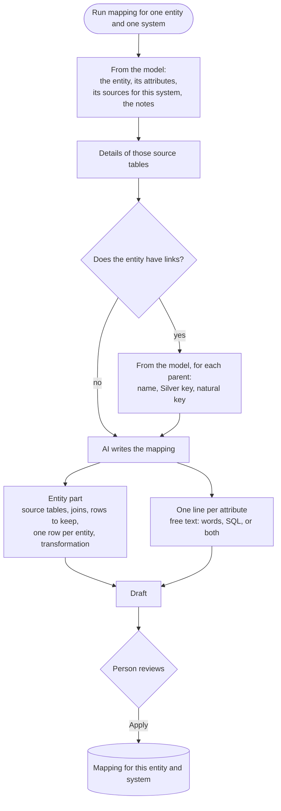

# Mapping

One Run writes the mapping for one entity and one source system. The mapping is a document a developer
could write the code from. Silver mapping reads Bronze. Gold mapping reads Silver.

## Flow



## Example: filling a link

- Bronze `kics_user_device_v1` has `tracking_system_user_id` = "U123", the source's own user number.
- Silver `User` has `UserID` = 501 (the Silver key) and `UserNumber` = "U123" (the natural key).
- Silver `UserDevice.UserID` must hold 501, not "U123".

The mapping line says: look up Silver `User` where `UserNumber` matches `tracking_system_user_id`, and take its `UserID`.

```sql
LEFT JOIN silver.User u ON u.UserNumber = ud.tracking_system_user_id
-- UserID = u.UserID
```

The three facts about the parent (name, Silver key, natural key) come from the **model**. In v2 they came
from the parent's own mapping, which was usually not saved yet, so the line was left blank.

## Decided

- **One Run is one entity for one source system,** like v2. Many can be picked and run one after another.
- **A mapping uses only the model as context, never another mapping.** Each Run can write its whole document alone.
- **A link is filled by looking up the parent's Silver table,** not the parent's Bronze table.
- **Two parts, stored as rows:**
  - Entity part: one row per entity and system, with text fields for the source tables, how they join,
    which rows to keep, how to get one row per entity, and the entity level transformation logic.
  - Attribute part: one line per attribute, with one free field for the transformation. Plain words, SQL,
    or both, whatever makes it clear to the person writing the code.
- **Silver mapping and Gold mapping are stored apart,** with the same two parts.
- **The mapping document is printed from these rows.**
- **Excel export and import** for the mapping sheets, built as its own module.

## Decided when we build it

- Exactly what the Run is given from the source tables (how much profiling, which relationships).
- The Excel layout.
- How the join is written (LEFT JOIN, trim both sides). This is a house standard, kept as Notes.
