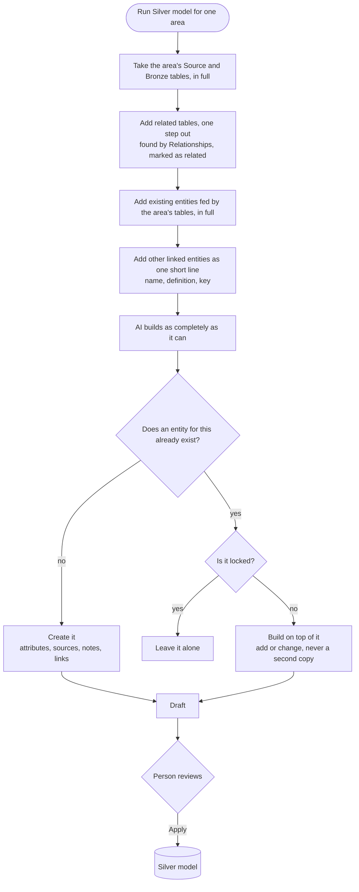

# Silver model

One Run builds the Silver entities for one subject area, as completely as it can. A later Run for another
area builds on top of what is already there.

## Flow

## What the AI writes

| Thing | Holds |
|---|---|
| Entity | Name, definition, Grain |
| Entity source | Which Source or Bronze table feeds the entity, plus a note for mapping |
| Attribute | Name, type, definition, and a mark if it is the natural key |
| Attribute source | Which column of those tables feeds the attribute, plus a note for mapping |
| Link | A child attribute pointing at a parent entity |

## Example: the parent is not built yet

Sales has `employee_id`. The `hr_employee` table is in the HR area, and HR has not been run.

1. The Sales Run is given `hr_employee` as a related table.
2. The AI creates the Employee entity as far as it can, and links `SalesOrder` to it.
3. When HR runs later, it is shown Employee in full and adds the rest.

Either order ends in the same model.

## Decided

- **One area per Run.** Review it, apply it, then run the next.
- **No area is an entity's "home".** Every Run builds as completely as it can. The next Run builds on top.
- **It works in both directions.** One table can feed several entities, and several tables can feed one entity. Any Source or Bronze table in scope can be a source (Nov 21, Maaz).
- **Existing entities are shown in full,** so the AI extends them and never creates a second one.
- **Related tables outside the area are given to the Run,** one step out, clearly marked. See [table-details.md](../shared/table-details.md).
- **Notes for mapping sit on the two source rows,** as the rationale did in v2. They say how, not why.
  Example: "use only rows where status is active".
- **Every entity marks its natural key.** Without it, a link to the entity cannot be mapped, and the orchestrator cannot merge.
- **A locked item cannot be updated or touched by a Run.**
- **Running an area again is free.**
- The tables have the same shape as v2.

## Decided when we build it

- Exactly what the Run is given for each table.
- Tools and prompts for the tool based Run.
