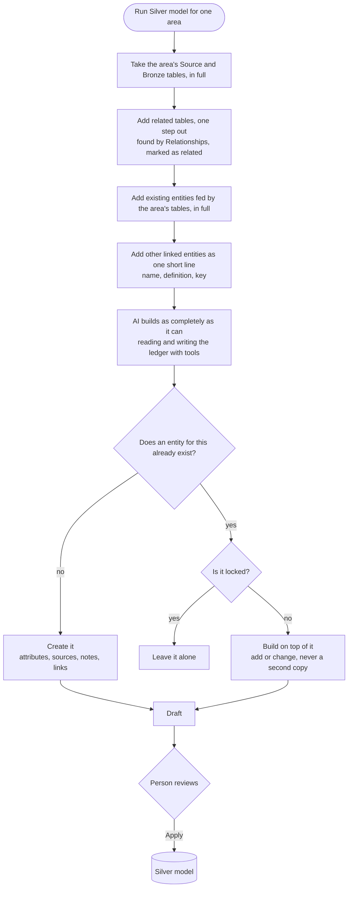

# Silver model

One Run builds the Silver entities for one subject area, as completely as it can. A later Run for another
area builds on top of what is already there.

## Flow



## Example: the parent is not built yet

Sales has `employee_id`. The `hr_employee` table is in the HR area, and HR has not been run.

1. The Sales Run is given `hr_employee` as a related table.
2. The AI creates a small Employee entity with only its surrogate key and natural key, and links `SalesOrder` to it.
3. When HR runs later, it is shown Employee in full and adds the rest.

Either order ends in the same model.

## Decided

### The Run (`operational`)

The AI builds the Silver model for one subject area: its entities, their attributes, where each comes from, and the
links between them.

**How it runs.** The person picks one area. It is a tool based Run, with samples: the AI gets the inputs below,
looks up more with the read tools, and writes its answer into the ledger with the write tools
([run.md](../overview/run.md)). The draft changes the `operational_` tables. Apply it before running the next area,
so that area sees these entities. The Run is refused if the area is switched off or empty, or if the project has no
Silver schema.

**Table change.** `operational_entity` gets `is_merged` (below). `operational_attribute` drops `is_audit_column`,
because audit columns are never part of the model.

| Input | Format | What it holds | Why the AI needs it |
|---|---|---|---|
| `operational_schemas` | rows | the project's Silver schemas, with what each is for | every entity goes in one |
| `operational_naming_instructions` | text | the project's naming style, or the default in `core/` | how entities, attributes and keys are named |
| `operational_audit_columns` | rows | the columns the load adds to every entity, such as `SourceSystemID` and the load time | the AI never models them or reuses their names |
| `operational_entity_types` | rows | the seeded entity types, such as `core`, `reference`, `transaction` and `transaction_line` | every entity gets one |
| `context_records` | grouped | `operational_model_requirement`, `kpi_requirement` and `source_information` | modeling rules, the KPIs the model must support, and facts about the systems |
| `systems` | JSON | the tenant and the systems of the tables below | Silver brings one thing from several systems together |
| `subject_area` | JSON | the area's name and definition | the focus of the Run |
| `area_tables` | blocks | the area's tables, each non-technical column with its definition, marks, inferred type, counts, samples and links | every attribute, type, key and link comes from here; a link's kind says what to do with it (below) |
| `related_tables` | blocks | the tables outside the area at the other end of those links, with only their keys and the columns that link | enough to link to them without modeling them |
| `existing_operational_entities` | JSON | in full, every entity built from an area table, as the ledger holds it when the Run starts, with its locks and what a person switched off | the AI builds on these and never makes a second copy |
| `related_operational_entities` | rows | one line per entity built from a related table, or linked to from an existing entity, as `list_entities` gives it | the AI links to them; to change one, it reads it in full first |

**Links sit on the columns.** Each column row in `area_tables` carries two lists. `links_to` holds the links that
start at this column, and `linked_from` the links from other tables that end at it. A `foreign_key` that comes in
from a table outside the area is left out, because that table's own area makes the link. Each link names the column at
its other end, with its `relationship_kind`, its `inferred_cardinality` read from the link's start to its end, and
its `validation_result`, which is `null` until relationship validation has run. Only active links are shown. A link
between two area tables shows on both of its columns. Columns in `related_tables` carry no link lists, because each
of their links to the area already shows on the area's side.

```text
<area_tables>
table {"object_schema":"salesforce","object_name":"Account","system_code":"SALESFORCE_CRM","row_count":52000,"object_definition":"Companies we sell to or work with.","object_grain":"One row per account (Id)."}
attribute_name|attribute_data_type|attribute_inferred_data_type|is_natural_key|is_surrogate_key|is_foreign_key_candidate|is_nullable|null_count|blank_count|distinct_count|attribute_definition|sample_values|links_to|linked_from
Id|ID(18)|STRING|true|false|false|false|0|0|52000|The account's Salesforce ID.|["0015g00000AbCdEAAV","0015g00000AbCdFAAV"]|[]|[{"object_schema":"salesforce","object_name":"Contact","attribute_name":"AccountId","relationship_kind":"foreign_key","inferred_cardinality":"many_to_one","validation_result":"supported"}]
Name|TEXT(255)|STRING|false|false|false|false|0|0|51870|The company's name.|["Northwind Traders","Contoso Ltd"]|[]|[]
SAP_Customer_Number__c|TEXT(10)|STRING|false|false|true|true|31000|0|21000|The customer's number in SAP, once the account is a customer there.|["12345","20077"]|[{"object_schema":"sap","object_name":"KNA1","attribute_name":"KUNNR","relationship_kind":"same_business_key","inferred_cardinality":"one_to_one","validation_result":null}]|[]
OwnerId|LOOKUP(User)|STRING|false|false|true|false|0|0|140|The salesperson who owns the account.|["0055g00000XyZ1AAAQ","0055g00000XyZ2AAAQ"]|[{"object_schema":"salesforce","object_name":"User","attribute_name":"Id","relationship_kind":"foreign_key","inferred_cardinality":"many_to_one","validation_result":"supported"}]|[]

table {"object_schema":"salesforce","object_name":"Contact","system_code":"SALESFORCE_CRM","row_count":180000,"object_definition":"People at the companies we work with.","object_grain":"One row per contact (Id)."}
attribute_name|attribute_data_type|attribute_inferred_data_type|is_natural_key|is_surrogate_key|is_foreign_key_candidate|is_nullable|null_count|blank_count|distinct_count|attribute_definition|sample_values|links_to|linked_from
Id|ID(18)|STRING|true|false|false|false|0|0|180000|The contact's Salesforce ID.|["0035g00000AbCdEAAV","0035g00000AbCdFAAV"]|[]|[]
AccountId|LOOKUP(Account)|STRING|false|false|true|true|1200|0|51000|The company the contact works at.|["0015g00000AbCdEAAV","0015g00000AbCdFAAV"]|[{"object_schema":"salesforce","object_name":"Account","attribute_name":"Id","relationship_kind":"foreign_key","inferred_cardinality":"many_to_one","validation_result":"supported"}]|[]
Email|EMAIL|STRING|false|false|false|true|9000|0|170500|The contact's email address.|[]|[]|[]
</area_tables>

<related_tables>
table {"object_schema":"salesforce","object_name":"User","system_code":"SALESFORCE_CRM","row_count":140,"object_definition":"Our sales and service staff who use Salesforce.","object_grain":"One row per user (Id)."}
attribute_name|attribute_data_type|attribute_inferred_data_type|is_natural_key|is_surrogate_key|attribute_definition
Id|ID(18)|STRING|true|false|The user's Salesforce ID.

table {"object_schema":"sap","object_name":"KNA1","system_code":"SAP_ERP","row_count":48000,"object_definition":"SAP's customer table: one row per customer.","object_grain":"One row per customer number (KUNNR)."}
attribute_name|attribute_data_type|attribute_inferred_data_type|is_natural_key|is_surrogate_key|attribute_definition
KUNNR|CHAR(10)|STRING|true|false|The customer's number in SAP, with leading zeros.
</related_tables>
```

Email has no samples because it is marked `is_pii`.

**What each link kind becomes.** A `foreign_key` becomes a link attribute, such as Contact's `CustomerID`
pointing at Customer. An `extension` makes the two tables one entity. A `same_business_key` makes one entity fed by
both systems, such as Customer from Salesforce Account and the SAP customer table. A `same_code_list` becomes one
merged code entity, such as Country.

**One row per system, or merged.** By default an entity keeps one row per system: Northwind in both Salesforce and
SAP is two Customer rows, told apart by `SourceSystemID`, and each system loads on its own. A **merged** entity
(`is_merged` true) keeps one row per real thing across all systems, such as Country, Currency or a master customer
list. The AI marks an entity merged only when a Note asks for it, or for a shared code list, and a person can change
it. A merged entity's natural key must mean the same thing in every system, such as an ISO country code, and its
attribute source notes say which system wins when they disagree ("Salesforce name first, then SAP"). It still gets
one mapping per system, as every entity does, and the code step combines them ([mapping.md](mapping.md) and
[code.md](code.md)).

**First area.** Nothing is modeled yet. When an area table points at a related table that no entity is built from,
the AI makes a small parent entity with only a surrogate key and a natural key. That table's own area fills it in
later.

**Later areas and reruns.** The AI extends existing and related entities under their saved names, and saves only
what changes. It may change only entities it was shown in full (RUN-007).

**What it writes.** Each entity is one `save_entity` call:

| Field | What it holds |
|---|---|
| `operational_entity_schema_name`, `operational_entity_name` | where the entity goes, and its name |
| `operational_entity_type_code` | one of the entity types |
| `operational_entity_definition`, `operational_entity_grain` | what it holds, and what one row means |
| `is_merged` | `false` for one row per system, `true` for one row across all systems |
| `sources` | its complete list of source tables, each with a note |

Its attributes follow in one or more `save_attributes` calls:

| Field | What it holds |
|---|---|
| `operational_attribute_name`, `operational_attribute_definition` | the attribute's name, and what it holds |
| `operational_attribute_data_type` | a Databricks type |
| `is_nullable`, `is_surrogate_key`, `is_natural_key` | its marks |
| `sources` | its complete list of source columns, each with a note |
| `link_to` | its parent entity, or `null` |

`remove_entity` and `remove_attributes` switch saved rows off and drop new ones. Each entity has exactly one
surrogate key, named and filled as the fixed conventions say, so it has no source. A natural key's note must be
exact, such as "Trim leading zeros", because every lookup to the entity is built from it.

For Contact, `save_entity` gets:

```json
{"operational_entity_schema_name": "silver_sales", "operational_entity_name": "Contact",
 "operational_entity_type_code": "core",
 "operational_entity_definition": "A person at a customer company.", "operational_entity_grain": "One row per contact.",
 "is_merged": false,
 "sources": [{"object_schema": "salesforce", "object_name": "Contact", "operational_entity_source_note": "All rows."}]}
```

and `save_attributes` gets:

```json
{"operational_entity_schema_name": "silver_sales", "operational_entity_name": "Contact",
 "attributes": [
  {"operational_attribute_name": "ContactID", "operational_attribute_definition": "Surrogate key: an identity column the load fills.",
   "operational_attribute_data_type": "BIGINT", "is_nullable": false, "is_surrogate_key": true, "is_natural_key": false,
   "sources": [], "link_to": null},
  {"operational_attribute_name": "SourceContactID", "operational_attribute_definition": "The contact's Salesforce ID.",
   "operational_attribute_data_type": "STRING", "is_nullable": false, "is_surrogate_key": false, "is_natural_key": true,
   "sources": [{"object_schema": "salesforce", "object_name": "Contact", "attribute_name": "Id",
                "operational_attribute_source_note": "As is."}], "link_to": null},
  {"operational_attribute_name": "CustomerID", "operational_attribute_definition": "The company the contact works at.",
   "operational_attribute_data_type": "BIGINT", "is_nullable": true, "is_surrogate_key": false, "is_natural_key": false,
   "sources": [{"object_schema": "salesforce", "object_name": "Contact", "attribute_name": "AccountId",
                "operational_attribute_source_note": "Look up Customer by its Salesforce account ID."}],
   "link_to": {"operational_entity_schema_name": "silver_sales", "operational_entity_name": "Customer"}}]}
```

**What Python adds.** When the Run ends, Python turns the ledger's changes into the draft. A new attribute gets the
next position after the saved ones, in the order the AI saved it.

**Load order.** `operational_entity_dependency_order` (parents first) is not part of the answer. A separate step
without AI works it out from the links when a person runs it, and writes a draft like every Run. A link from an
entity to itself is ignored. If links form a loop, the log names it and those entities are ordered by name. A person
can also edit the order in the web app, and a locked entity keeps its order. OPERATIONAL-009 *(Warning)* says when a
parent loads after its child.

**Renaming.** A person can rename an entity or attribute in the web app. The row keeps its id, so its sources,
mapping and locks stay attached. The AI never renames.

**Rules.** OPERATIONAL-001 (source tables are in scope), OPERATIONAL-002 (attribute sources come from the entity's
source tables) and OPERATIONAL-003 (a link points at an active entity). *Proposed:* OPERATIONAL-004 to 007,
OPERATIONAL-008 and 009 *(Warnings)*, PROJECT-001 and CHANGE-SET-012 (the type code).

### Also decided

- **One area per Run.** Review it, apply it, then run the next.
- **No area is an entity's "home".** Every Run builds as completely as it can. The next Run builds on top.
- **It works in both directions.** One table can feed several entities, and several tables can feed one entity. Any Source or Bronze table in scope can be a source (Nov 21, Maaz).
- **Existing entities are shown in full,** so the AI extends them and never creates a second one.
- **Related tables outside the area are given to the Run,** one step out, clearly marked. See [table-details.md](../shared/table-details.md).
- **Notes for mapping sit on the two source rows,** as the rationale did in v2. They say how, not why.
  Example: "use only rows where status is active".
- **Every entity marks its natural key.** Without it, a link to the entity cannot be mapped, and the orchestrator cannot merge.
- **A locked item cannot be updated or touched by a Run.**
- **Running an area again is free.**
- The tables have the same shape as v2, plus `is_merged` on the entity and without `is_audit_column` (Nov 28, Maaz).

## Decided when we build it

- The prompt text, with its notes on using the tools ([run.md](../overview/run.md)).
