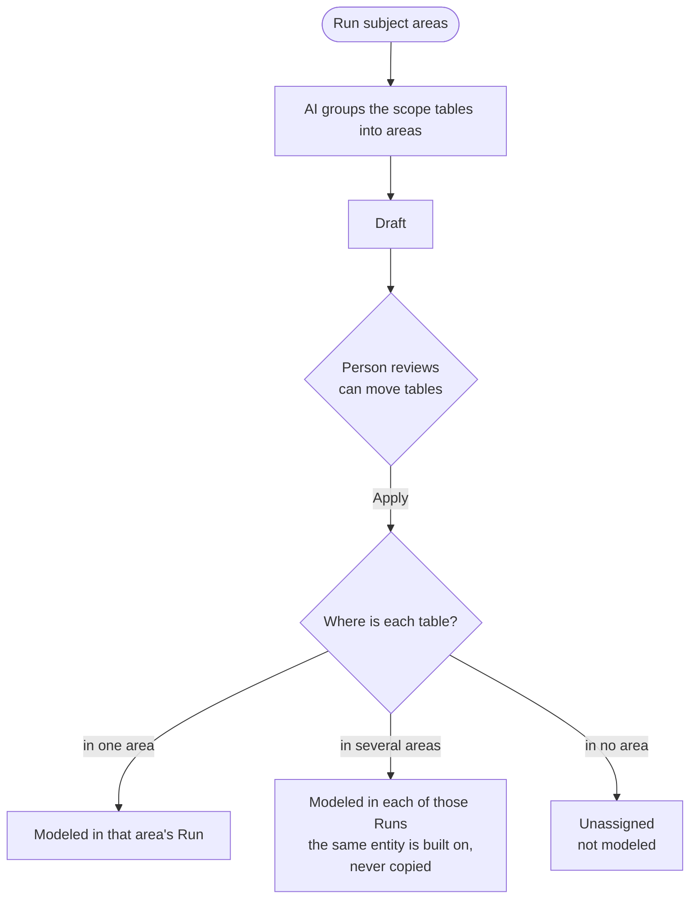

# Subject areas

The AI groups the scope tables into business areas, like Sales or HR. An area decides which tables a
Silver or Gold Run works on.

## Flow



## Decided

### The Run (`subject_area`)

The AI groups the scope tables into subject areas. Each area then gets its own Silver and Gold Run.

**How it runs.** The person presses Run with nothing to pick. One AI call covers the whole scope, without samples.
The answer is saved to `subject_area` and `subject_area_table`.

**Table change.** `project_config` gets `subject_area_target_column_count`, a whole number that defaults to 800.

| Input | Format | What it holds | Why the AI needs it |
|---|---|---|---|
| `systems` | JSON | the tenant and every system in scope | areas often span systems |
| `context_records` | grouped | `source_information` and `subject_area_requirement` | facts about the systems, and how the tenant wants tables grouped ("keep service cases in their own area") |
| `scope_tables` | rows | every scope table with its definition, Grain, row count, column count and current areas | definitions are what areas are built from; row counts tell big business tables from small code tables; column counts let the AI keep each area near the target size; current areas show the tables in no area yet |
| `subject_area_target_column_count` | number | the project setting: about how many columns one area should hold in total (default 800) | a guide only; it keeps each area's Silver Run, which reads every column of the area, at a workable size |
| `table_relationships` | rows | one row per pair of linked tables, with the linking columns; `same_code_list` links are left out, because a shared code list is no reason to group tables | linked tables usually belong together; the columns tell a business link (Contact.AccountId) from bookkeeping (a created-by column) |
| `existing_subject_areas` | JSON | the saved areas with their tables and locks, and `locked_out_tables`: tables a person took out of an area | a rerun builds on them; an empty area a person made is a domain to fill |

**First Run.** Every business table goes into at least one area, master data and code lists included, and a table
can be in more than one area (Account in both Sales and Service). The AI keeps a lifecycle (an order, its lines and
its history) together, and tables linked by `same_business_key` too. It aims to keep each area at or near the
target column count, and leaves technical tables out. The target is guidance in the prompt; nothing checks it.

**Reruns.** Unchanged areas are left out. A table in no area goes into an unlocked area that fits, or a new one. An
area that is given back has its full table list, and keeps its definition word for word unless its boundary
changed. A locked area is shown but never changed and gets no new tables, so a table that belongs only there stays
in no area and SUBJECT-AREA-002 shows it. To rename an area, the AI switches the old one off and gives a new one.

**What it gives back.** A list of `subject_areas`:

| Field | What it holds |
|---|---|
| `subject_area_name` | the area's name, unique in the project |
| `subject_area_definition` | the area's boundary, which the Silver Run uses as its focus |
| `tables` | the area's complete list of tables |
| `is_active` | `false` only to switch a saved area off |

```json
{"subject_areas": [{"subject_area_name": "Sales",
  "subject_area_definition": "Customer companies, their contacts, and the deals we work on with them.",
  "tables": [{"object_schema": "salesforce", "object_name": "Account"},
             {"object_schema": "salesforce", "object_name": "Contact"},
             {"object_schema": "salesforce", "object_name": "Opportunity"}],
  "is_active": true}]}
```

**Rules.** SUBJECT-AREA-001: every table of an active area is in scope. SUBJECT-AREA-002 *(Warning)*:
every scope table is in an area.

### Also decided

- The AI groups the tables. The person can change the groups.
- A table can be in more than one area.
- A table in no area is not modeled. SUBJECT-AREA-002 warns about it.
- No area is a table's "home". See [silver-model.md](silver-model.md).
- The step can be run again, with no restrictions.
- No sample values are used here.

## Built (Nov 28)

- `core/subject_areas.py`, with the starter prompt `database/seed/prompts/subject_area.md`.
