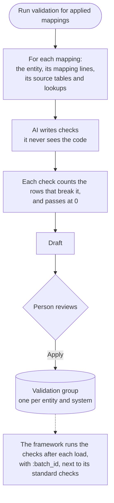

# Validation

The AI writes checks that test one entity's loaded table for one system, after the code has run. It works from the
applied mapping, never from the code, so a check can fail when the code is wrong.

## Flow



## Decided

### The Run (`operational_validation`, `dimensional_validation`)

The AI writes business, mapping and technical checks for one entity's loaded table and one system, which run after
the code. The standard checks are run by a separate framework, so the AI never writes them.

**How it runs.** The person picks applied mappings. Each gets one AI call, with samples and no tools. The checks are
saved in the validation group for that entity and system, which Python creates the first time. The Run is
refused if the mapping is not applied or the group is locked.

**Table change.** Each validation group gets the entity's id, unique together with the system, and drops its name.
It keeps its project, and a two-column key makes sure the entity is in that project.

**How a check stays meaningful.** A check must be able to fail when the code is wrong. These rules are part of the
fixed guidance in the prompt:

- **The AI never sees the code.** It works from the applied mapping and the source tables. A check written from the
  code would repeat the code's mistakes, so it could never fail.
- **The framework's checks are never repeated.** The prompt names them: the natural key is unique per system, each
  required attribute is never null, and each link holds a real parent key. The surrogate key needs no check, because
  an identity column cannot repeat.
- **Every check compares the loaded table with something the code did not produce:** the source rows read through
  the mapping, a parent entity, Silver for a Gold entity, or a rule from a Note. Its description names the
  mistake it would catch. When the AI cannot name one, it writes no check.
- **No made-up numbers.** Every check counts the rows that break it, and passes at 0. A rule with no exact meaning,
  and an attribute with no mapping line, are not checked, and the group's description lists them.

**What it checks.** Each kind of check is a category:

| Category | What the query counts | The mistake it catches |
|---|---|---|
| `completeness` | rows of the batch that the row filter keeps, but that are missing from the target | a join or filter in the code drops rows |
| `referential` | rows whose parent row exists, found the way the mapping line says, but whose link is null or holds another key | a lookup on the wrong key, format or system, or the wrong history row |
| `transformation` | rows whose value differs from the mapping line worked out again from the source; copied columns are compared together, in one check | a wrong rule, column or CAST |
| `business_rule` | rows that break a `validation_requirement` Note | data the business says cannot happen |
| `reconciliation` | in Gold, a measure's total that differs from the Silver rows it came from | a join that drops or doubles fact rows |

The severity is `blocking` for every category except `business_rule`, which takes the severity its Note gives,
or `warning`.

**Fixed rules for the SQL.** These are built in, with no exception:

- A check is one SELECT that returns one count. Python sets its pass condition: result type `integer`, operator
  `equal`, value type `literal` and value `0`.
- A check may use `:batch_id`, which the framework supplies when it runs the checks, as it does for the code. Source
  and Bronze tables are read as in the code: the driving table filtered on `:batch_id`, the others joined on their
  batch column as well. The target, its lookups and other Silver or Gold tables are never filtered by batch.
- A check keeps to this system's rows, with `JOIN meta.system AS sys ON sys.SystemCode = '<system-code>'` and
  `SourceSystemID = sys.SystemID`. For a merged entity, it matches on the natural key only, and compares values only
  on rows whose `SourceSystemID` is this system.
- With history, a check compares with the current row in Silver, and in Gold with the row valid on the fact's date.
- Values are compared with `IS DISTINCT FROM`, so a null on one side counts. With `<>`, a value the code wrongly
  leaves null would never be counted.
- No check counts target rows that the row filter leaves out of this batch, because an earlier batch may have
  loaded them while they still passed.

| Input | Format | What it holds | Why the AI needs it |
|---|---|---|---|
| `context_records` | grouped | `validation_requirement`, and `mapping_requirement` for the house standards the code applies | the business rules to check, and how values should look |
| `systems` | JSON | the tenant and this system | each check keeps to this system's rows |
| `target_entity` | block | the `entity` line with its SQL name, `is_merged` and `scd_type`, then one row per column of the loaded table in load order: its type, marks, nullability, `link_to` by alias and applied mapping line; the audit columns come last, marked, with their definitions | what each column should hold, and how to find the current row |
| `mapping_part` | JSON | the applied row filter, sample query and transformation | which source rows should arrive, and how they join |
| `mapping_tables` | blocks | the mapping's tables and lookup entities, built as in mapping with the same aliases, plus each one's SQL name and batch column; a lookup also lists its audit columns | real names for every table a check reads, and the values to expect |
| `existing_checks` | JSON | the group's saved checks with their locks, or `none` | a rerun builds on them |

**Reruns.** A rerun gives only the checks it adds or changes. It switches off a check whose attribute, link or
Note has gone, and never changes a locked one.

**What it gives back.** The group's description, and a list of `checks`. Each check has a name, a description, a
category, a severity and a query. For Workday Employee, with the Note "Every active worker has a job profile":

```json
{"operational_validation_group_description": "Workday rows of Employee: every worker arrives, the job profile lookup, the copied hire date and the job profile rule. Not checked: IsContractor, which has no mapping line.",
 "checks": [
  {"operational_validation_check_name": "Every worker in the batch arrives",
   "operational_validation_check_description": "Workers of the batch missing from Employee. Catches a join or filter that drops rows.",
   "validation_category_code": "completeness", "validation_severity": "blocking",
   "validation_query_sql": "SELECT count(*) FROM (SELECT w.Worker_ID FROM workday.Worker AS w WHERE w.batch_id = :batch_id EXCEPT SELECT e.WorkerID FROM silver_people.Employee AS e JOIN meta.system AS sys ON sys.SystemCode = 'WORKDAY_HR' WHERE e.SourceSystemID = sys.SystemID) AS missing",
   "is_active": true},
  {"operational_validation_check_name": "Job profile lookup finds the right row",
   "operational_validation_check_description": "The position's job profile is in JobProfile, but JobProfileID is null or points at another row. Catches a lookup on the wrong key, format or system.",
   "validation_category_code": "referential", "validation_severity": "blocking",
   "validation_query_sql": "SELECT count(*) FROM workday.Worker AS w JOIN workday.Position AS p ON p.Position_ID = w.Position_ID AND p.batch_id = w.batch_id JOIN meta.system AS sys ON sys.SystemCode = 'WORKDAY_HR' JOIN silver_people.JobProfile AS jp ON jp.SourceJobProfileID = p.Job_Profile_ID AND jp.SourceSystemID = sys.SystemID JOIN silver_people.Employee AS e ON e.WorkerID = w.Worker_ID AND e.SourceSystemID = sys.SystemID WHERE w.batch_id = :batch_id AND e.JobProfileID IS DISTINCT FROM jp.JobProfileID",
   "is_active": true},
  {"operational_validation_check_name": "Hire date is copied as is",
   "operational_validation_check_description": "Employees whose HireDate differs from Workday's Hire_Date. Catches a wrong column or a lost value.",
   "validation_category_code": "transformation", "validation_severity": "blocking",
   "validation_query_sql": "SELECT count(*) FROM workday.Worker AS w JOIN meta.system AS sys ON sys.SystemCode = 'WORKDAY_HR' JOIN silver_people.Employee AS e ON e.WorkerID = w.Worker_ID AND e.SourceSystemID = sys.SystemID WHERE w.batch_id = :batch_id AND e.HireDate IS DISTINCT FROM w.Hire_Date",
   "is_active": true},
  {"operational_validation_check_name": "Every active worker has a job profile",
   "operational_validation_check_description": "Active workers of the batch with no job profile, from the Note \"Every active worker has a job profile\".",
   "validation_category_code": "business_rule", "validation_severity": "warning",
   "validation_query_sql": "SELECT count(*) FROM workday.Worker AS w JOIN meta.system AS sys ON sys.SystemCode = 'WORKDAY_HR' JOIN silver_people.Employee AS e ON e.WorkerID = w.Worker_ID AND e.SourceSystemID = sys.SystemID WHERE w.batch_id = :batch_id AND w.Worker_Status = 'Active' AND e.JobProfileID IS NULL",
   "is_active": true}]}
```

**Note for the prompt texts.** The validation prompt has a worked example with made-up names. It also shows two
checks the AI must not write, with the reason: one copied from the code, and one that compares the target with
itself.

**Rules.** CHANGE-SET-012 *(Proposed)*: the category and severity come from their lists. VALIDATION-001
*(Proposed)*: a check's pass condition fits together, for hand edits. CODE-002 *(Proposed)*, as in code.
VALIDATION-002 *(Proposed, Warning)*: a query reads the loaded table, and no table outside its inputs except
`meta.system`.

### Also decided

- **Stored like v2,** split like mapping and code: `*_validation_group` and `*_validation_check`.
- **A validation group belongs to one entity and one system** and keeps its project (Nov 28, Maaz). It has no name.
- **The standard checks are not stored here.** A separate framework runs them on every entity.

## Decided when we build it

- The prompt text, with its worked example and the two checks it must not write.
