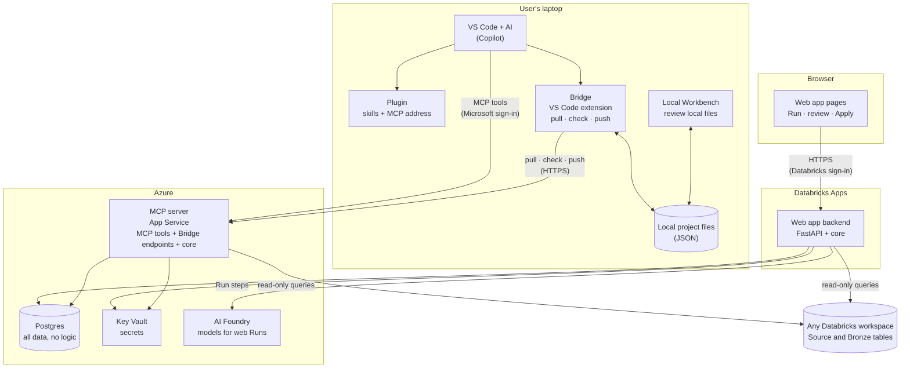
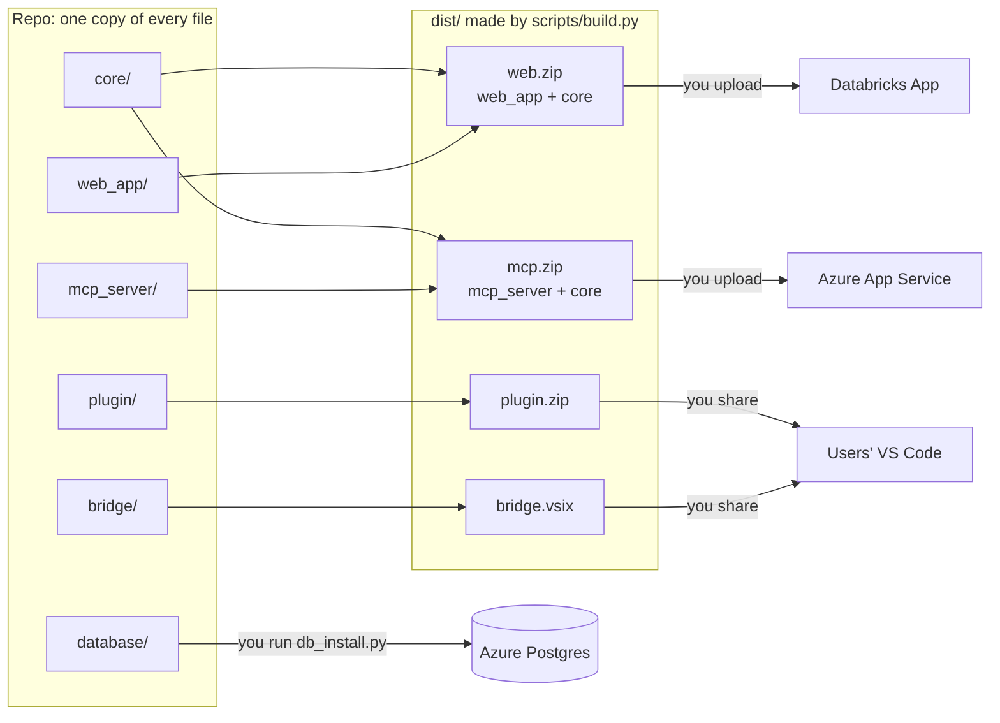
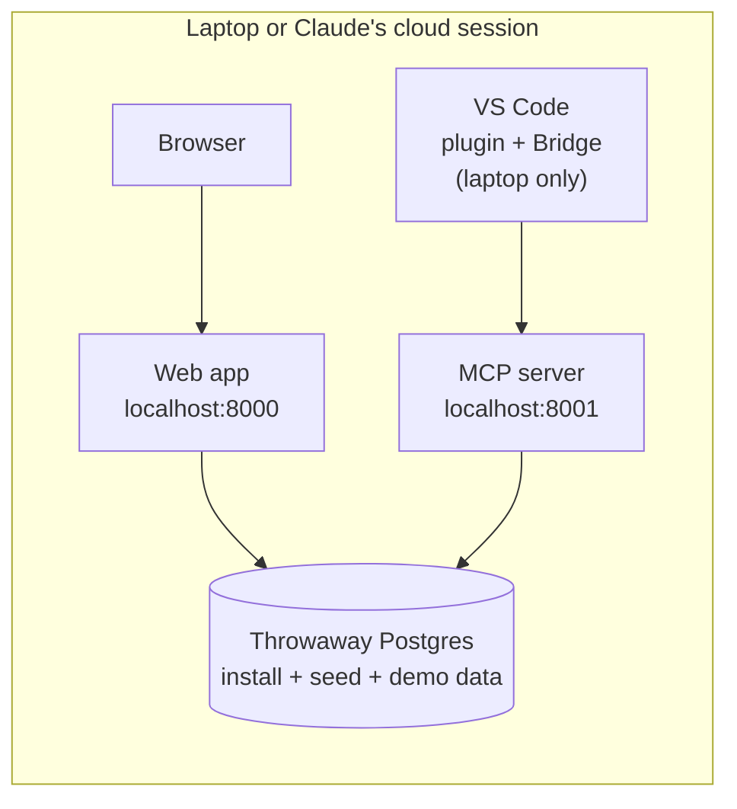
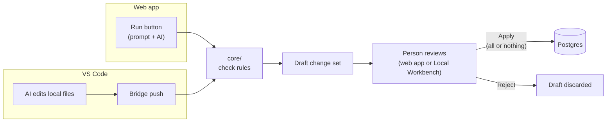

# Architecture (10,000-foot view)

Words used here are defined in `terminology.md`.

## Components and where they run

## How it gets built and deployed (by hand)

There is no GitHub Actions and no automatic deploy. `scripts/build.py` runs on your laptop and writes files
into `dist/`. You upload or share them yourself, the same way as v2.

`core/` is not a separate server or a third deployment. It is just a folder of Python code. The build
script copies it into **both** zips, next to the web app code and next to the MCP server code. The repo has
one copy; each zip carries its own copy. When `core/` changes, rebuild and upload both zips.

Each zip gets a `version.txt` (git commit and build time). Both servers show it on their `/health` page,
so you can see at a glance that the web app and the MCP server run the same code.

## How we test locally

Claude never touches the live apps. Everything is tried on a local copy first, on your laptop or in
Claude's cloud session (which has no VS Code, so it tests the web app and MCP server only).

- **Demo data**: demo tenants, one demo user per role, a catalog of three made-up systems (SAP-style ERP,
  Salesforce-style CRM, Workday-style HR, about 22 tables) and a demo project, so every page has something to show.
  It lives in its own folder, `database/demo/`, apart from install and seed, and never goes to Azure.
- **Local sign-in**: you pick a demo user, so each role can be tried.
- **No fake AI or fake Databricks** (Nov 21, Maaz): they bloated v2 and pointed the wrong way. How to try
  Runs and profiling locally is decided when those steps are built.

## How one change flows

Both ways in end in the same `core/` functions and the same kind of draft change set.

## What each piece does

| Piece | Runs on | Job |
|---|---|---|
| `core/` | inside the web app and the MCP server | All logic: reads and writes Postgres, checks rules, builds drafts, Apply, SQL generation |
| Web app | Databricks Apps | Pages for every step, Run buttons, review and Apply, prompts, admin, AI cost control |
| MCP server | Azure App Service | Tools for AI in VS Code (and other AI tools); pull, check and push for the Bridge |
| Plugin | laptop | Skills that tell the AI how to do each step; the MCP address |
| Bridge | laptop (VS Code) | Moves project files between laptop and server without passing them through the AI |
| Local Workbench | laptop (VS Code) | Shows local changes and check results; Apply button |
| Postgres | Azure | All data: access, catalog, pipelines, projects, models, mapping, code, change sets, prompts, runs |
| Key Vault | Azure | Database login, Databricks workspace credentials, Foundry access |
| AI Foundry | Azure | AI models for web Runs |
| Databricks workspaces | anywhere the network allows | Source and Bronze data; read-only queries for profiling |
